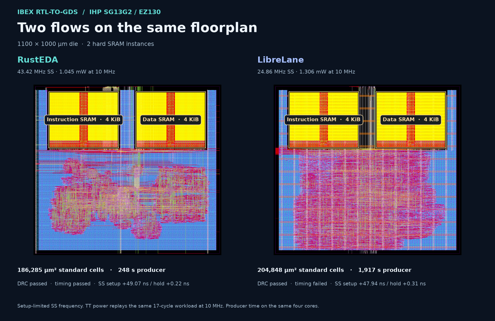
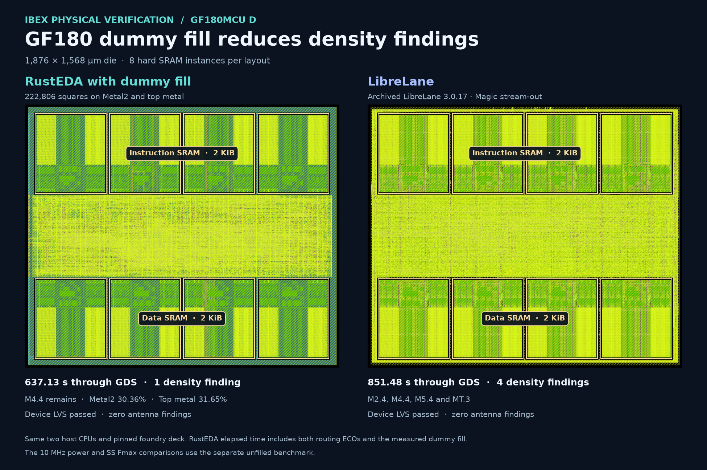

<p align="center">
  
</p>

<p align="center">
  <strong>Clean-room, AI-agent-native RTL-to-GDS suite in Rust.</strong><br>
  Daemonless revisioned workspaces · Deterministic single-binary flows · Formal equivalence · Three open PDKs<br><br>
  <a href="https://lab-emi.github.io/RustEDA/">Documentation</a> ·
  <a href="#verified-performance-across-three-pdks">Benchmarks</a> ·
  <a href="#multi-design-generalization">Non-Ibex Cores</a> ·
  <a href="#the-tool-suite">Modules</a> ·
  <a href="#start-building">Quick Start</a> ·
  <a href="LICENSE">Apache-2.0</a>
</p>

<picture>
  <source media="(prefers-reduced-motion: reduce)" srcset="docs/assets/rusteda-banner.svg">
  
</picture>

## Why RustEDA

Legacy open-source EDA flows wrap multiple C++/Tcl processes with opaque state and 10–30 minute turnaround loops. **RustEDA** rebuilds the core stack from scratch in Rust — synthesis (`RustSys`), static timing (`RustSTA`), physical implementation (`RustROAD`), differentiable SPICE (`RustSpice`), shared arenas/formats (`RustEDA-Common`), and an interactive workbench (`RustEDA Studio`) — around **fast, deterministic, machine-inspectable closed-loop design**:

- **3.55×–8.39× faster RTL-to-GDS** than LibreLane 3.0.17 across `IHP SG13G2`, `SKY130A`, and `GF180MCU D` on four open-source designs (`Ibex`, `PicoRV32`, `AES-128`, `SHA-256`), with bit-exact GDS reproducibility and up to **4.8× less peak RAM**.
- **Built for AI agents & closed-loop iteration**: Zero background daemons. Every CLI mutation acquires `workspace.lock`, guards optimistic concurrency via `--base-rev` (`REVISION_CONFLICT`), emits bounded `rusteda.v1` JSON with shell-safe handles (`rev3`, `path1`, `sel1`), and shares live mmap views with `RustEDA Studio`.
- **Independent verification by default**: Black-box ABC formal equivalence (including reset-reachable FSM state-correspondence discovery), Magic + KLayout DRC, Netgen LVS, vendor simulation, and `≤ 0.270 ps` OpenSTA parity.

---

## Verified Performance Across Three PDKs

### 1. Ibex + Hard SRAM (Paired Quiet-Host Three-Block Medians vs LibreLane 3.0.17)

Both flows build Ibex with hard SRAM macros from identical RTL, 100 ns (10 MHz) constraints, die areas, and macro placements, checked by identical independent signoff scripts. Values show **RustEDA / LibreLane**.

| Open PDK & Flow | RTL to GDS (3-block median) | Peak RSS / Repro | Stdcell Area (µm²) | Power @ 10 MHz (mW) | SS Ceiling @ 10 MHz¹ | Independent Checks |
| --- | ---: | --- | ---: | ---: | ---: | --- |
| **IHP SG13G2** (2 SRAMs, 4 cores) | **219.6 / 1,745.5 s**<br>**7.95× faster** (`3.27×` signoff) | Deterministic<br>single binary | 186,285 / 204,848<br>**−9.1%** | 1.045 / 1.306 (VCD)<br>**−20.0%** | 43.42 / 24.86 MHz<br>**+74.6%** | **9/9 PASS** (0 DRC, 0 ant., 0 DRV vs LL timing fail) |
| **SKY130A** (2 OpenRAMs, 2 cores, **clean single binary, non-PGO**)² | **499.6 / 1,771.8 s**<br>**3.55× faster** (`0.34%` spread) | **631 MiB** Max RSS<br>**3/3 bit-exact GDS** | 173,881 / 176,427<br>**−1.4%** | 6.15 / 9.50 (vec.)<br>**−35.3%** | 23.82 / 17.21 MHz<br>**+38.4%** | **0/0 Magic+KL DRC, 0/0/0 DRV** (vs 3,035/381/64), LVS/Sim/ABC PASS, 14 vs 13 ant. |
| **GF180MCU D** (1 SRAM + fill, 2 cores)³ | **591.3 / 885.6 s**<br>**1.50× faster** (`1.53×` pub. pair) | Deterministic<br>with floating fill | 475,913 / 490,812<br>**−3.0%** | 91.24 / 94.33 (VCD)<br>**−3.3%** | 10.91 / 10.75 MHz<br>**+1.5%** | **0/0 ant.**, LVS/Sim/ABC PASS, **1 vs 3** density findings |

¹ *Not a tight-clock Fmax race:* both flows targeted a relaxed 100 ns clock (`AREA 0` in LibreLane); see [Tight-Clock Fmax](#3-tight-clock-fmax-stress-across-all-three-pdks) below for genuine frequency stress.  
² Replaces the archived 2026-11-18 SKY130A `r02` recipe (which used PGO, 5 `.work` binaries, and 2 manual channels; `1,665.5 vs 1,370.0 s` against LibreLane's 105-antenna `drt-jumpers` arm) with a standard non-PGO single-binary flow (`clean_sky130_flow.py`, zero manual channels, zero hardcoded rewires) confirmed in 3 quiet-host alternating blocks against `librelane-recipe`.  
³ GF180MCU D 3-block median compares against LibreLane's screened `drt-jumpers-fill` arm (82 antenna findings); the published single-run pair with 0/0 antenna measured `594.1 / 911.0 s` (`1.53×`).

[Full Three-PDK Receipts](docs/benchmarks/ibex-three-pdk.md) · [Clean SKY130A Confirmation](docs/benchmarks/ibex-three-pdk.md#clean-single-binary-sky130a-comparison-2026-11-20) · [Fairness Audit](docs/benchmarks/ibex-three-pdk.md#comparison-fairness-and-known-asymmetries)

---

### 2. Multi-Design Generalization (Non-Ibex Open-Source Cores)

To rule out single-design overfitting, three permissive open-source RTL cores (`picorv32_top`, `aes_core`, `sha256_core`) were run end-to-end at 50 ns (20 MHz) against LibreLane 3.0.17 with zero per-design routing hacks:

| Design & PDK | RTL to GDS (RustEDA / LibreLane) | Speedup | Peak RAM Delta | SS Fmax (MHz) | Area / Power Delta | Independent Signoff |
| --- | ---: | ---: | ---: | ---: | --- | --- |
| **`picorv32_top`** (IHP SG13G2) | **172.6 / 1,447.5 s** | **8.39×** | **4.1× less RSS** | **46.03** / 38.77 (**+18.7%**) | −21.8% power | **8/8 PASS** |
| **`aes_core`** (IHP SG13G2) | **291.6 / 1,931.3 s** | **6.62×** | **3.6× less RSS** | **64.12** / 37.63 (**+70.4%**) | −3.0% area, −11.8% WL | **8/8 PASS** |
| **`sha256_core`** (IHP SG13G2) | **114.0 / 615.7 s** | **5.40×** | **4.8× less RSS** | **65.07** / 46.79 (**+39.1%**) | Comparable | **8/8 PASS** |
| **`sha256_core`** (SKY130A) | **249.5 / 397.0 s** | **1.59×** | Bounded | **37.03** / 33.01 (**+12.2%**) | −16.9% power | **0/0 DRC**, LVS & ABC PASS |

[Multi-Design Benchmark Report & Receipts](docs/benchmarks/multi-design.md)

---

### 3. Tight-Clock Fmax Stress Across All Three PDKs

Testing genuine frequency limits (with LibreLane upgraded to `SYNTH_STRATEGY = "DELAY 4"`):

| PDK & Clock Target | RustEDA SS Fmax | LibreLane `DELAY 4` SS Fmax | Speedup & Signoff Context |
| --- | ---: | ---: | --- |
| **IHP SG13G2 @ 25 ns** | **45.00–49.46 MHz** | 41.34 MHz | **9.5× faster**, −11% area, −21% VCD power, **9/9 PASS** (LL: 107 SS DRVs) |
| **SKY130A @ 40 ns** | **31.93 MHz** | 26.06 MHz | **+22.5% Fmax**, **4.15× faster**, 0 vs 2 hold, 28/5 vs 4,326/526/140 SS DRVs (LL lower vec. power: 5.16 vs 6.70 mW) |
| **IHP SG13G2 @ 20 ns** | 45.05–49.04 MHz | **50.50 MHz** | LibreLane stretches +3–12% higher at **13.5× slower** runtime, +13.6% area, +26.3% power, 107 SS DRVs |
| **GF180MCU D @ 65 ns** | 14.65–14.86 MHz | **16.58 MHz** (`d=60`) | LibreLane reaches higher setup Fmax (`14.29 MHz` on `DELAY 0`) but **fails SS hold (−0.228 ns)** and zero-delay sim |

[Tight-Clock Fmax Analysis & Engine Roadmap](docs/benchmarks/tight-clock-fmax.md)

---

### 4. Standalone Engine Head-to-Heads

Measured on identical prepared Ibex SG13G2 inputs (2026-11-13 campaign + Nov 13–14 follow-ups; see [Full Benchmarks](docs/benchmarks.md)):

| Engine vs Counterpart | Speed | Peak Memory | Quality / Verification |
| --- | --- | --- | --- |
| **[RustSys](modules/RustSys)** vs Yosys + ABC | **33.8× faster** (`47.4×` direct) | **6.6× less** | −1.8% area, depth 36 vs 40, ABC CEC + reset-reachable FSM LEC |
| **[RustSTA](modules/RustSTA)** vs OpenSTA 3.1.0 | **2.0× faster** (4T) / **1.6×** (2T) | **12.6% / 29.5% less** | Worst slacks within **0.270 ps** on identical SPEF |
| **[RustROAD](modules/RustROAD)** routing vs OpenROAD | **7.8× faster** (in-flow) | — | −7.7% routed wire, −1.3% vias, `i64` DBU-exact GDS |
| **[RustROAD](modules/RustROAD)** GDS export vs KLayout | **2.8× faster** | **2.0× less** | DBU-exact native GDSII streamout |
| **[RustROAD](modules/RustROAD)** extract vs OpenRCX | **0.85× faster** at 4T (**1.52× slower** at 2T) | 1.31× more | Total capacitance +6.0% vs OpenRCX |
| **[RustSpice](modules/RustSpice)** vs ngspice-45 (RC nets) | **4.1–7.0× faster** | **1.4–2.1× less** | 10/10 nominal-grid pass; 857 pass / 0 fail ngspice-47 suite; `1x L^T U^T` adjoints |

---

## Side-by-Side GDS Layouts

Published Ibex layouts (**RustEDA left**, **LibreLane right**; embedded captions preserve their original receipt-bound single-run figures while the tables above report repeated three-block medians):






---

## The Tool Suite

| Component | Role | Repository / Source |
| --- | --- | --- |
| **RustEDA CLI & Flow** | Native step-graph executor (`rusteda flow exec`), checkpoints, recovery & JSON telemetry | [`apps/`](docs/modules.md) |
| **RustEDA Studio** | Interactive hierarchy, timing cone & RTL cross-probing synced over shared selections | [`apps/`](apps/docs/index.md) |
| **[RustSys](https://github.com/lab-emi/RustSys)** | Bounded RTL synthesis, AIG optimization, Liberty mapping & formal LEC | `modules/RustSys` |
| **[RustSTA](https://github.com/lab-emi/RustSTA)** | Deterministic multi-corner NLDM + SPEF RC static timing analysis | `modules/RustSTA` |
| **[RustROAD](https://github.com/lab-emi/RustROAD)** | Electrostatic placement, CTS, routing, antenna repair, RC extraction & GDSII | `modules/RustROAD` |
| **[RustSpice](https://github.com/lab-emi/RustSpice)** | Differentiable SPICE simulator (SoA SIMD, Cranelift JIT LU, discrete adjoints) | `modules/RustSpice` |
| **[RustEDA Common](https://github.com/lab-emi/RustEDA-Common)** | Pinned foundation: generational arenas, format parsers, mmap workspaces & SoA compute | `modules/RustEDA-Common` |

---

## Built for AI Agents

1. **Plan & verify before running**: `rusteda flow exec --dry-run` hashes tools, PDK views, and manifests before touching disk.
2. **Stream & stop cleanly**: Emit machine-readable JSONL via `--events`, stop after any named stage (`--stop-after`), and inspect progress concurrently via `rusteda flow exec-status`.
3. **Optimistic concurrency**: Every mutating command requires `--base-rev <rev>` and fails cleanly with `REVISION_CONFLICT` on stale state; concurrent read-only queries and Studio views never block writers.
4. **Honest receipts**: Every run records input/output SHA-256 hashes, analysis scope (`corner`, `wire_model`, `unconstrained_endpoints`), and explicit `unverified` verdicts whenever a check is omitted or hits a budget cap.

[Native PDK Recipe](integration/ibex_pdks/NATIVE.md) · [Flow Operations & Recovery](docs/flows.md) · [Executor JSON Contract](apps/docs/specs/flow/exec.md)

---

## Start Building

Baseline requirements: Linux, Git, Python 3.11+, and Rust 1.100.0 (plus native GUI deps if building Studio with default features).

```sh
git clone --recurse-submodules https://github.com/lab-emi/RustEDA.git
cd RustEDA
./dev doctor
./dev shared
./dev build RustEDA --release --no-default-features --memory-mib 4096
./rusteda --help
```

### Run a verified workspace flow

```sh
./rusteda tools configure
./rusteda tools verify
./rusteda flow --workspace .work/counter init --base-rev empty --design counter --pdk sky130
./rusteda flow --workspace .work/counter run --base-rev rev0
./rusteda flow --workspace .work/counter report --summary-only
```

Use `./dev build <Module> --release` to build individual engines (`RustSys`, `RustSTA`, `RustROAD`, `RustSpice`, `RustEDA-Common`) inside bounded cgroup RAM/timeout caps. See [Development Guide](docs/development.md) and [PDK Setup](docs/pdks.md).

---

## Honest Scope & Known Limits

- **Timing-driven macro synthesis & setup sizing**: `rustsys synth --timing-period` does not yet support opaque macro buses and `RustROAD` lacks post-placement setup cell upsizing — explaining why LibreLane `DELAY 4` stretches higher on ultra-tight 20 ns IHP and 65 ns GF180 clocks.
- **2-thread RC extraction**: Native extraction beats OpenRCX narrowly at 4 threads (`0.85×`) but stays `1.52×` slower at 2 threads (`1.31×` RSS).
- **Compact transistor models & full-SoC signoff**: RustSpice supports diodes and Level-1 MOS (not BSIM4/PSP103); IR/EM, crosstalk/SI, CPPR, full-SoC routing (PULPissimo / OpenC910), and foundry tapeout signoff remain outside current qualification.
- **Withdrawn archive**: Historical full-SoC PULPissimo synthesis timings were withdrawn after an AXI width-cast error and remain archived with full provenance in [PULPissimo Archive](docs/benchmarks/pulpissimo.md).

See [Qualification Scope](docs/verification.md) and [Provenance](docs/provenance.md).

## License

Apache-2.0 — see [LICENSE](LICENSE). External reference tools, PDKs, rule decks, and benchmark RTL retain their own licenses and are invoked strictly as black-box executables over standard file formats.
