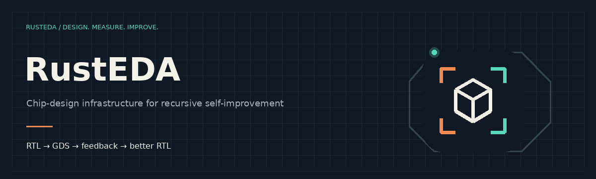

# RustEDA tool suite

| Tool · repository | Function |
| --- | --- |
| [RustEDA CLI](https://github.com/lab-emi/RustEDA) | Unified commands for design workspaces, libraries and engine tools. |
| [RustEDA flow](https://github.com/lab-emi/RustEDA) | RTL-to-GDS flow execution, checkpoints and recovery. |
| [RustEDA workbench (Studio)](https://github.com/lab-emi/RustEDA) | Design hierarchy, critical paths, logic cones and shared selections. |
| [RustSys](https://github.com/lab-emi/RustSys) | RTL synthesis, technology mapping and equivalence checks. |
| [RustSTA](https://github.com/lab-emi/RustSTA) | Static timing, constraints, parasitics and incremental analysis. |
| [RustROAD](https://github.com/lab-emi/RustROAD) | Placement, clock trees, routing, extraction and GDS. |
| [RustSpice](https://github.com/lab-emi/RustSpice) | Differentiable SPICE circuit simulation and adjoint sensitivity. |
| [RustEDA Common](https://github.com/lab-emi/RustEDA-Common) | Shared design models, format parsers, disk workspaces and compute kernels. |

CLI, flow and workbench live in this repository under `apps/`. The five engine
modules have independent repositories and exact source pins.

<p align="center">
  
</p>

<h1 align="center">Infrastructure for chip-design self-improvement</h1>

<p align="center">Shorten the work between inference steps. Design, measure, and improve.</p>

<p align="center">
  <a href="https://lab-emi.github.io/RustEDA/">Documentation</a> ·
  <a href="docs/benchmarks.md">Benchmarks</a> ·
  <a href="#start-building">Get started</a> ·
  <a href="LICENSE">Apache-2.0</a>
</p>

<picture>
  <source media="(prefers-reduced-motion: reduce)" srcset="docs/assets/rusteda-banner.svg">
  
</picture>

RustEDA is Rust infrastructure for **chip-design RSI — recursive self-improvement**:
an agent proposes a design change, tools implement and check it, and measured
results guide the next change. Its purpose is to reduce the synthesis, timing,
physical-design and orchestration delays **outside the LLM inference loop**.
RSI here means iterative design optimization; it is not a claim of autonomous
model self-improvement.

Fast inference is only part of a fast iteration. RustEDA pairs native engines
with revisioned disk workspaces, machine-readable results and explicit verification
so agents and engineers can act on the same design state.

## RustEDA vs LibreLane at a glance

Ibex RTL-to-GDS on IHP SG13G2 with EZ130 cells and two SRAM macros, 2026-11-13: RustEDA and LibreLane 3.0.17 (OpenROAD, Yosys, KLayout, Magic, Netgen) ran one after the other on the same 4-vCPU host from the same prepared inputs, and the same signoff scripts checked both layouts. Every RustEDA engine was built with Rust 1.100.0, and RustEDA's step graph ran under its Rust executor, `rusteda flow exec`. ([receipt](docs/benchmarks/ibex-sg13g2-ez130-host-20261113.json))

**4.4× faster end to end** (752 s against 3,283 s with both flows' foundry
checks on the same schedule; 3.5× with every check run one after another), with a
**5.2 % smaller, 7.7 % shorter-wired layout, 1.3 % fewer vias and zero timing
violations** where LibreLane's layout has 112.

| Stage | RustEDA | LibreLane | RustEDA |
| --- | ---: | ---: | ---: |
| Synthesis | 3.10 s | 124.93 s | **40.3× faster** |
| Placement and clock tree | 19.56 s | 41.21 s | **2.1× faster** |
| Repair before detailed routing | 13.85 s | 48.36 s | **3.5× faster** |
| Routing, global and detailed | 266.71 s | 2,083.40 s | **7.8× faster** |
| Static timing in the flow | 26.96 s | 138.93 s | **5.2× faster** |
| Parasitic extraction | 9.51 s | 38.97 s | **4.1× faster** |
| GDS / DEF / netlist export | 1.67 s | 266.29 s | **159× faster** |
| Foundry DRC / antenna / LVS on each layout¹ | 278 / 127 / 93 s | 379 / 169 / 135 s | **1.4× / 1.3× / 1.5× faster** |
| Whole flow² | 717.30 s | 2,766.39 s | **3.9× faster** |
| **End to end** (flow + every signoff check) | **751.54 s** | **3,283.05 s** | **4.4× faster** |

| Quality of results | RustEDA | LibreLane | RustEDA |
| --- | ---: | ---: | ---: |
| Standard-cell area | 187,585.2 µm² | 197,913.7 µm² | **5.2 % smaller** |
| Routed signal wirelength | 895,279.2 µm | 969,571.6 µm | **7.7 % shorter** |
| Vias | 120,585 | 122,194 | **1.3 % fewer** |
| Capacitance / fanout violations, TT + SS | 0 | 112 | **timing-clean** |
| Setup worst slack, TT / SS | 49.63 / 49.43 ns | 48.60 / 47.84 ns | **+1.03 / +1.59 ns** |
| Synthesis and final equivalence | proven | unverified | **proven** |

| Module against its open-source counterpart | Speed | Peak memory | Quality |
| --- | --- | --- | --- |
| RustSys vs Yosys + ABC (LibreLane script) | **33.8× faster** (47.4× in direct mode) | **6.6× less** | 1.8 % less area, logic depth 36 vs 40, equivalence proven |
| RustSTA vs OpenSTA | **1.6× faster** at 2 threads, **2.0×** at 4 | **29.5 % less** at 2 threads, **12.6 % less** at 4³ | worst slacks within 0.270 ps |
| RustROAD routing vs OpenROAD (in the flow) | **7.8× faster** | — | 7.7 % less wire, 1.3 % fewer vias |
| RustROAD extraction vs OpenRCX | level at 4 threads (0.91×, faster in 15 of 15 runs, ranges overlap), **1.64× slower** at 2³ | **1.3× more**³ | total capacitance 6.0 % above OpenRCX's |
| RustROAD GDS export vs KLayout | **2.8× faster** | **2.0× less** | — |
| RustSpice vs ngspice-45 (extracted RC nets) | **4.1–7.0× faster** | **1.4–2.1× less** | closer to the reference in 10 of 10 cases on the nominal grid, 6 of 10 at each simulator's own output points |

¹ Same scripts and decks on both layouts, interleaved runs at the same load (medians), on the 4-vCPU VM the session
moved to after a container restart ([shared gates](docs/benchmarks.md#shared-gates-2026-11-13)).
² RustEDA's flow time includes its own foundry DRC, antenna and LVS; LibreLane's does not.
³ After the campaign: RustSTA `de210a6` ([RustSTA peak memory and RustROAD extraction](docs/benchmarks.md#ruststa-peak-memory-and-rustroad-extraction-2026-11-13))
and RustROAD `8d29a61` ([RustROAD extraction, second round](docs/benchmarks.md#rustroad-extraction-second-round-2026-11-14)) against OpenSTA, OpenRCX and the
campaign's binaries in the same runs. In the campaign, RustSTA used
13.6 % less at 2 threads and 11.8 % more at 4, and RustROAD's extraction was 1.22× slower at 4 threads and 2.19× at 2.

LibreLane's layout fails the shared timing gate (112 maximum-capacitance and fanout violations at TT and SS) and its equivalence check does not complete, so the receipt keeps its own ratio fields null under its publication rule; the multiples here divide the recorded times. Stages are paired by phase, not as identical tasks. Against the three losses of 2026-11-05, in same-load runs: repair before global routing now takes 0.73× the time of LibreLane's two pre-route resizer steps (ranges do not overlap; 1.18× on 2026-11-05), OpenRCX on RustEDA's layout is level with its time on LibreLane's (1.00×, ranges overlap; 1.36× on 2026-11-05) and the latch-up check on RustEDA's layout takes 0.76× its time on LibreLane's (1.11× with the checker of that campaign). RustEDA is still not faster or not better everywhere: RustROAD's standalone extraction took 1.22× OpenRCX's time at 4 threads in the campaign and, after two changes since, is level at 4 threads (0.91×, faster in every run but with overlapping ranges) and 1.64× slower at 2; the timing gate is level (0.98×, ranges overlap) and its layout keeps less hold margin. RustSTA's peak memory at 4 threads, 11.8 % above OpenSTA's in the campaign, is 12.6 % below it since a change after the campaign ([details](docs/benchmarks.md#ruststa-peak-memory-and-rustroad-extraction-2026-11-13)). [All stages, gates and losses](docs/benchmarks.md#ibex-host-campaign-2026-11-13)

## Latest development · 2026-11-13

On a 4-vCPU Xeon cloud host, the repository's native recipe and engines
(superproject `820ffc8`, every engine built with Rust 1.100.0) and LibreLane
3.0.17 built Ibex on IHP SG13G2 with EZ130 cells and **two real SRAM macros**
from the same prepared inputs, and the same nine independent gate scripts
checked both layouts (one timed sample per flow). For the first time the native
step graph ran under RustEDA's Rust executor, `rusteda flow exec`, instead of
the Python `producer.py`, and no frontend step runs Python any more. **RustEDA's
producer completed all 114 steps, including the 1 ps RustSTA/OpenSTA parity
gate (largest difference 0.270 ps), and its layout passes every shared gate that
gives a pass/fail verdict:** foundry main and antenna DRC with 0 violations,
latch-up tap coverage, LVS, TT/SS timing with zero setup, hold, slew,
capacitance and fanout violations, simulation, synthesis and final equivalence
`proven`, and density. The OpenRCX extraction gate, which extracts the SPEF for
the timing gate, reports `extracted_not_qualified` on both layouts, as before.
The run is still `unqualified`, because the recipe was composed without the
unpublished component-qualification evidence. LibreLane again fails the timing
gate on max-capacitance and fanout checks (setup and hold met), and its
equivalence is `unverified` (a checker limitation with 433 renamed registers,
not evidence of non-equivalence).

RustEDA: 187,585.2 µm² standard-cell area, 895,279.2 µm routed signal wire,
120,585 vias, 751.54 s end to end (sv2v preparation, the producer with its own
extractions, timing signoff and foundry DRC, antenna DRC and LVS, and the shared
latch-up, simulation, equivalence and density gates). LibreLane: 197,913.7 µm²,
969,571.6 µm, 122,194 vias, 3,675.96 s (preparation, the flow through
`Checker.XOR` and all nine shared gates one after another; 3,283.05 s with its
DRC, antenna and LVS on the producer's two-lane schedule). Because LibreLane
fails a gate, the receipt keeps its own ratio fields null; the summary above
divides these recorded times.

The three losses of 2026-11-05 are closed in same-load runs: the frontend STA
and ECO stage, whose ECO rounds and planning helpers are now `rusteda` commands,
takes 0.73× the time of LibreLane's two resizer steps before global routing
(median 13.21 s against 18.20 s; 0.30× all four of its repair steps), OpenRCX
extraction is level on the two layouts (1.00×) after a route change that cut the
native DEF's wire pieces by about a sixth, and the latch-up gate takes 0.76× its
time on LibreLane's layout. In same-load reruns of the shared gates, the native
layout is ahead on foundry main DRC (0.73×), antenna DRC (0.75×), LVS (0.69×),
latch-up, simulation and density, and level on timing and OpenRCX extraction;
the equivalence gate has no valid comparison, because it does not complete on
LibreLane's layout. In the campaign RustEDA lost two module head-to-heads: RustROAD's
own extraction took 1.22× OpenRCX's time at 4 threads (2.19× at 2; level at
1.05× on 2026-11-05, on another host and layout), and RustSTA's peak memory at 4
threads was 11.8 % above OpenSTA's (13.6 % below at 2 threads). Since then, in
same-load runs against the campaign's binaries, RustSTA `de210a6` uses 12.6 %
less peak memory than OpenSTA at 4 threads ([details](docs/benchmarks.md#ruststa-peak-memory-and-rustroad-extraction-2026-11-13)),
and RustROAD `8d29a61` extracts in 0.71× its campaign time, level with OpenRCX at
4 threads (0.91×, faster in all 15 runs but with overlapping ranges) and still
1.64× slower at 2 ([details](docs/benchmarks.md#rustroad-extraction-second-round-2026-11-14)). The native
layout also keeps less hold margin (TT 0.108 ns against 0.172 ns, both met).

The host is again a different virtual machine, and every LibreLane stage took
less time on it than on 2026-11-05 with byte-identical DEF and netlists, so the
two campaigns' times are history, not a before/after. The same-load gate reruns
ran on a third VM after a container restart, both layouts alike. Earlier
campaigns and the retained R20/R21 native runs remain on the benchmark page;
times from different hosts are not comparable.

[Published source versions](docs/development-snapshot.md) ·
[Current modules and remaining limits](docs/engine-status.md) ·
[Measurements, receipts and qualification scope](docs/benchmarks.md)

## Optimize the whole loop

```text
          propose                         implement                        measure
  Agent ───────────► RTL / Netlist ───────────────────────► GDS / Waveforms ────────► Feedback
    ▲                RustSys · RustSTA · RustROAD · RustSpice                       │
    └─────────────────────────────── next iteration ────────────────────────────────┘
                               RustEDA flow + workbench
```

If tools account for fraction `f` of an iteration, and their aggregate speedup
is `s`, Amdahl's law gives:

$$S_{\mathrm{iteration}} = \frac{1}{(1-f) + f/s}.$$

**Illustration:** when tools consume 80% of an iteration, making that entire
tool portion 10× faster yields **3.57×** overall speedup. This is a model,
not a measured RustEDA result. Faster synthesis alone cannot establish faster
RTL-to-GDS or faster agent iterations.

## One benchmark campaign

The [Ibex SG13G2/EZ130 benchmark page](docs/benchmarks.md) is the single public performance source for RustEDA and its modules; module pages link to it. It holds the 2026-11-13, 2026-11-05 and 2026-11-02 host campaigns, the retained R20/R21 native runs and the historical 2026-10-30 matched comparison, each with a machine-readable receipt ([host 2026-11-13](docs/benchmarks/ibex-sg13g2-ez130-host-20261113.json) · [host 2026-11-05](docs/benchmarks/ibex-sg13g2-ez130-host-20261105.json) · [host 2026-11-02](docs/benchmarks/ibex-sg13g2-ez130-host-20261102.json) · [R20/R21](docs/benchmarks/ibex-sg13g2-ez130-development.json) · [historical](docs/benchmarks/ibex-sg13g2-ez130.json)).

The host campaigns add module head-to-heads. On identical inputs: RustSys against Yosys with ABC (LibreLane's synthesis script), RustSTA against OpenSTA, RustROAD extraction against OpenRCX and RustROAD GDS export against KLayout. RustROAD placement, CTS and routing are compared with OpenROAD's stages inside the two flows. RustSpice is compared with ngspice-45 on RC networks extracted from the final Ibex layout, not at transistor level: it does not support IHP's PSP103 transistor models. RustSpice is not timed in the RTL-to-GDS main flow.

## PDKs and standard-cell libraries

| Process | Standard-cell library | Verified scope |
| --- | --- | --- |
| SkyWater SKY130A | `sky130_fd_sc_hd`, `hdll`, `hs`, `ms`, `ls`, `lp`, `hvl` | HD: synthesis, timing and small-block physical flow qualification. Other libraries: installed; integrated physical flow unverified. |
| GlobalFoundries GF180MCU | `gf180mcu_fd_sc_mcu7t5v0`, `gf180mcu_fd_sc_mcu9t5v0` | 7T: synthesis, timing and small-block physical flow qualification. The 9T library is also a library-coverage baseline, not the qualified physical-flow default. |
| IHP SG13G2 | `sg13g2_stdcell`, [EZ130 8T v1.1](https://iip.ethz.ch/ez-library/ihp130-8t.html) | EZ130: Ibex with two real SRAMs completes native RTL-to-GDS with all 16 gates (retained runs on one host). Host campaigns with reconstructed EZ130 tech LEF and GDS: on 2026-11-13 and 2026-11-05 the recipe of the day passed every shared gate with a pass/fail verdict and the 1 ps RustSTA/OpenSTA parity gate; on 2026-11-02 the earlier recipe passed every design gate but not the parity gate. All are `unqualified`. Other EZ130 designs: unverified. IHP standard cells: installed; integrated flow unverified. |

Select an installed Liberty corner for direct RustSys commands with
`./rusteda library NAME --corner tt` (also `ff` or `ss` where catalogued).
The selector checks the exact library SHA-256; `./rusteda library --help` lists
the names. Use `--root DIR` or the documented environment override for an
installation in a different location. For example:

```sh
EZ130_LIB=$(./rusteda library ez130_8t --corner tt) || exit 1
rustsys synth --top counter --lib "$EZ130_LIB" \
  --out counter_ez130.v path/to/counter.sv
```

EZ130 is a cell library for the IHP process, not a PDK on its own. Its v1.1
tie-cell Liberty driver types conflict with the supplied Verilog models; its
equivalence scope and functional supplement are documented in the
[EZ130 functional model scope](modules/RustSys/docs/verification/pdk.md#additional-ihp-sg13g2-benchmark-library).
For SRAM, `./rusteda sram sky130 --corner tt` locates a representative macro's views
and reports their hashes; use `gf180` or `ihp` to select another process, and
`--macro NAME` selects another installed
macro. SKY130 has SRAM22 and OpenRAM options, while GF180 and IHP ship prebuilt
foundry macros. Some SRAM22 macro configurations were tested in silicon at
1.8 V and 25 MHz, as documented by the [macro provider](https://github.com/ucb-substrate/sram22_sky130_macros).
The integrated `./rusteda flow --pdk` accepts `sky130` and `gf180`. The IHP
flow takes an explicit `ihp_sg13g2_ez130` worker configuration
(`./rusteda flow init --config FILE`, prepared by
[`integration/ibex_sg13g2_ez130`](integration/ibex_sg13g2_ez130/README.md)).
It is qualified only for the Ibex benchmark; SRAM integration for other designs
remains unverified.
See [PDK and SRAM setup](docs/pdks.md) for paths, provenance and compiler limits.

## Start building

Git, Python 3.11+, Rust 1.100.0 and a native Linux build environment are the
development baseline. Python drives the development harness; Rust core crates
do not depend on it. Studio has additional native GUI dependencies.

```sh
git clone --recurse-submodules https://github.com/lab-emi/RustEDA.git
cd RustEDA
./dev status
./dev doctor
./dev build RustEDA --no-default-features --memory-mib 4096
./rusteda --help
./dev build RustSys RustSTA RustSpice --release
```

The `./dev` entrypoint serializes builds, limits memory and worker concurrency,
and records resource use. Use `./dev --help` and the
[development guide](docs/development.md) for bounded checks and module selection.

## Run a verified design loop

Supply the documented, pinned tools and PDKs on Linux, with Podman and a user
systemd manager. Setup verifies existing inputs; it does not download tools or PDKs.

```sh
./rusteda tools configure
./rusteda tools verify
./rusteda flow --workspace .work/counter init --base-rev empty --design counter --pdk sky130
./rusteda flow --workspace .work/counter run --base-rev rev0
./rusteda flow --workspace .work/counter report --summary-only
```

Current physical qualification covers **eight small blocks × two PDKs**:
15 ordinary passes and one explicitly declared minimum-pulse-width deviation.
Cache reuse requires verified input and artifact identities. Interrupted runs
require explicit recovery.
See [flow operation](docs/flows.md) and [scope and evidence](docs/verification.md).

## License and provenance

Apache-2.0. Each module retains its own LICENSE and NOTICE. Benchmark designs,
PDKs, reference executables and rule decks retain their respective licenses;
those assets are not relicensed by this repository. Reference-tool comparisons
use external executables and documented file interfaces.
