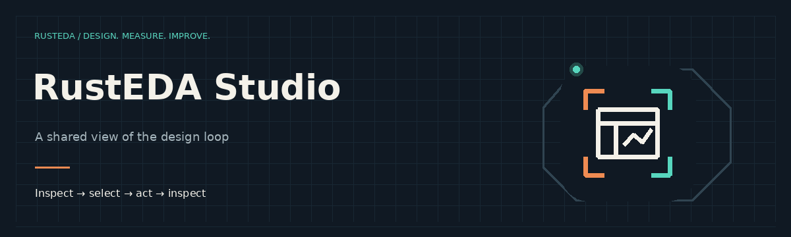

<p align="center">
  
</p>

<h1 align="center">A shared view of the design loop.</h1>

<p align="center">
  <a href="https://lab-emi.github.io/RustEDA/modules/rusteda-studio/">Documentation</a> ·
  <a href="https://github.com/lab-emi/RustEDA">RustEDA</a> ·
  <a href="https://lab-emi.github.io/RustEDA/benchmarks/">Benchmarks</a> ·
  <a href="LICENSE">Apache-2.0</a>
</p>

<picture>
  <source media="(prefers-reduced-motion: reduce)" srcset="docs/assets/rusteda-studio-banner.svg">
  
</picture>

RustEDA Studio shows hierarchy, timing paths, bounded logic cones and RTL cross-probing. Engineers and agents coordinate through revision-bound selections in the same disk workspace.

Part of **[RustEDA](https://github.com/lab-emi/RustEDA)**, infrastructure for chip-design recursive self-improvement. Native tools shorten the work between inference steps; verified results guide the next iteration.

## Quick start

```bash
cargo build --release -p rusteda-studio         # see "Linux system libraries" below
target/release/rusteda-studio -w path/to/ws     # the window, following HEAD
target/release/rusteda-studio -w path/to/ws --print            # the panels as text
target/release/rusteda-studio -w path/to/ws --rev rev2         # a pinned revision
target/release/rusteda-studio -w path/to/ws --select path1 -v  # share sel1, log reloads
```

Options: `--poll-ms` and `--debounce-ms` (watcher), `--fanin` and `--fanout` (cone levels),
`--split flattened|core` (hierarchy separators), `--max-rows` (`--print`). Errors are coded
`U0001` to `U0199` ([diagnostics](docs/specs/studio/diagnostics.md)); the exit status is 0, 1
(workspace, revision, window) or 2 (command line).

## The human–agent loop

The workbench and the tools coordinate through the workspace only:

1. The workbench shows `rev2` and the user selects a violating path: it atomically writes
   `ui_state.json` with `"revision": "rev2"`, `"selection_handle": "sel1"` and the handles
   `path<N>` and `inst<N>` of that revision.
2. An agent runs a tool on that selection, for example the synthesis tool's `resize` with
   `--target sel1 --base-rev rev2`; the tool resolves `sel1` against `rev2` only and commits
   `rev3`.
3. The workbench sees the new `manifest.json`, loads `rev3` in the background and shows it,
   keeping the focus on the same path by its endpoint; `ui_state.json` stays pinned to `rev2`.

The workbench writes nothing else: no table, no revision, no history line.

## Architecture

```text
crates/apps/rusteda-studio
├── src/model/   the headless model: loading (snapshot), watcher, hierarchy, timing view,
│                cone extraction, layered layout, scene, RTL index and cross-probe, selection,
│                the Studio state and its commands, the --print text
├── src/gui/     the GPUI front end (feature `gui`, default): window, panels, cone canvas
├── src/main.rs  the command line
└── tests/       model tests on workspaces built with the shared crates, the command line,
                 the loader as a job run, and view tests on the framework's test platform
```

The model depends on `rusteda-core` and `rusteda-workspace` only; it reads timing through the
shared read-only view of the timing table, never through a tool's engine. The front end renders
the model and forwards actions; it holds no EDA state. Every traversal is bounded (Rule 3.4):
cones by depth, nodes, edges, net fanout and pin visits, the layout by virtual nodes and sweeps,
searches and tables by their row budgets. See the [specification](docs/specs/studio/README.md)
and [ADR 0001](docs/adr/0001-gui-toolkit.md) for the framework.

Shared implementations are provided by the pinned RustEDA-Common dependency. This repository
keeps its product CLI adapter, consumer tests, and shared specifications.

## Linux system libraries

The framework links `libxkbcommon`, `libxkbcommon-x11`, `libxcb`, `libfreetype` and
`libfontconfig` and loads Vulkan at run time. On a host without the development links of
`libxkbcommon-x11` and `libX11-xcb`, see CONTRIBUTING, "Linux system libraries", for links in the
ignored `.work/` directory passed through `LIBRARY_PATH`. Without a display the window runs under
`xvfb-run` with a software Vulkan driver and a window manager.

## Scope and limits of 0.1

- Polling, not kernel file events: two `stat` calls per poll (default 250 ms).
- The synthesis tool of the suite gives its instances generated, flat names, so its netlists show
  a flat hierarchy; the RTL path survives in its state nets, which cross-probing uses.
- Cross-probing matches names; it does not elaborate the RTL.
- Cones do not stop at sequential cells (the netlist alone does not say which cells are
  sequential); their depth budget bounds them instead.
- Verified on Linux (X11 through Xvfb, software Vulkan); macOS is not verified.

## Development

```bash
cargo fmt --all --check
cargo clippy --workspace --all-targets --all-features -- -D warnings
cargo test --workspace
cargo xtask layout && cargo xtask coverage && cargo xtask shared check
```

See [CONTRIBUTING.md](CONTRIBUTING.md) for the rules and the full list of checks, and
[CHANGELOG.md](CHANGELOG.md).

## Security

See [SECURITY.md](SECURITY.md).

## License

Apache-2.0 ([LICENSE](LICENSE), [NOTICE](NOTICE)).
