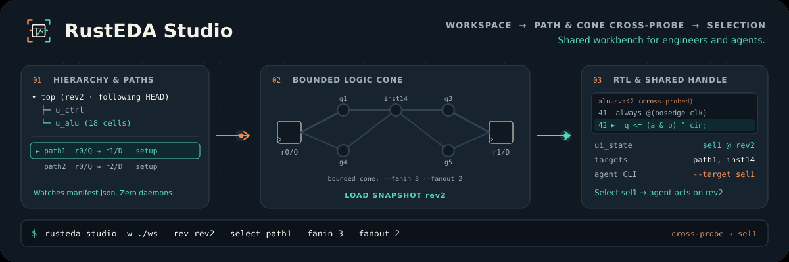

# RustEDA workbench

The RustEDA workbench shows hierarchy, timing paths, bounded logic cones and RTL cross-probing. Engineers and agents coordinate through revision-bound selections in the same disk workspace.

[All RustEDA modules](https://lab-emi.github.io/RustEDA/)

<picture>
<source media="(prefers-reduced-motion: reduce)" srcset="assets/rusteda-studio-banner.svg">

</picture>

- [Workbench](specs/studio/README.md)
- [CLI](specs/studio/cli.md)
- [Workspace](specs/studio/workspace.md)
- [Selections](specs/studio/selection.md)
- [Verification](verification/requirements.md)

## Open a workspace

```sh
./dev build RustEDA --memory-mib 4096 --timeout 900
./rusteda studio --workspace path/to/ws
```

For headless use, build with `--no-default-features` and add `--print` to the studio command.
