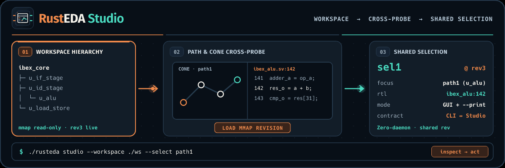

# RustEDA Studio

Interactive chip-design workbench built directly on the shared RustEDA disk workspace — inspect hierarchy, timing paths, bounded logic cones, and cross-probe RTL lines in sync with CLI and AI-agent sessions.

[All RustEDA modules](https://lab-emi.github.io/RustEDA/) · [CLI spec](specs/studio/cli.md) · [Architecture](../application-integration.md)

<picture>
  <source media="(prefers-reduced-motion: reduce)" srcset="assets/rusteda-studio-banner.svg">
  
</picture>

## Key Capabilities

- **Zero-daemon live sync**: Reads memory-mapped `.rbin` workspace snapshots (`rev1`, `rev2`, …) without locking out concurrent CLI commands or flow runs.
- **Revision-bound selections (`sel1`, `path1`)**: Engineers and AI agents coordinate over identical shell-safe selection handles persisted in the disk workspace.
- **Headless + GUI modes**: Build full interactive UI via `./dev build RustEDA` or headless inspection (`--print`) via `--no-default-features`.

## Open a Workspace

```sh
./dev build RustEDA --memory-mib 4096 --timeout 900
./rusteda studio --workspace path/to/ws
```

For headless / CI use, build with `--no-default-features` and pass `--print` to `./rusteda studio`.

## Specifications

- [Workbench overview](specs/studio/README.md) · [CLI contract](specs/studio/cli.md) · [Workspace](specs/studio/workspace.md) · [Selections](specs/studio/selection.md) · [Verification](verification/requirements.md)
