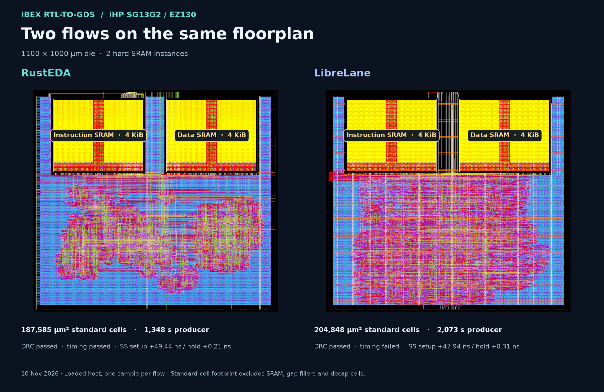
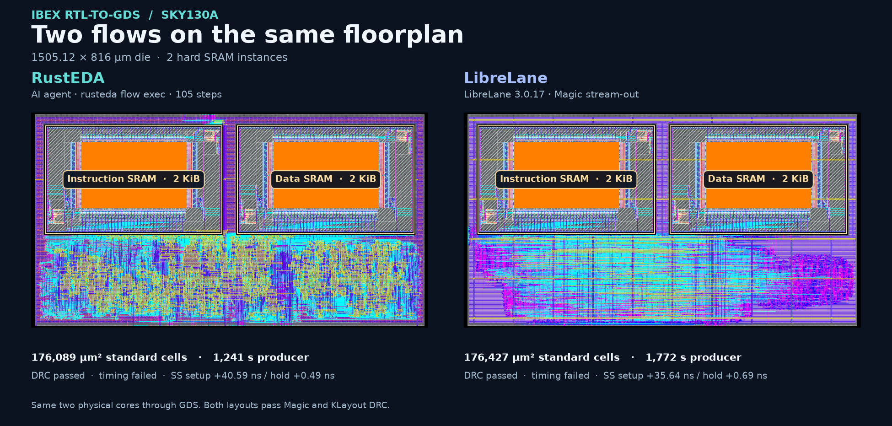

# Ibex RTL-to-GDS across three open PDKs

**IHP SG13G2 · SKY130 · GF180MCU.** RustEDA and LibreLane 3.0.17 implement
Ibex RV32IMC with separate instruction and data SRAM banks. Within each PDK,
both flows read the same RTL, constraints, macro views and floorplan. Each pair
uses the same signoff scripts. Bank capacity and the cell library vary by PDK.

| Open PDK | Standard cells | Hard SRAM in each layout |
| --- | --- | --- |
| IHP SG13G2 | EZ130 8T | Two IHP 1,024 × 32 macros, one 4 KiB bank each |
| SKY130A | `sky130_fd_sc_hd` | Two OpenRAM 512 × 32 macros, one 2 KiB bank each. This macro configuration was included in the [UCSC OpenRAM MPW2 tape-out](https://escholarship.org/uc/item/9dc0v8g3). |
| GF180MCU D | `gf180mcu_fd_sc_mcu7t5v0` | Eight foundry 512 × 8 macros, four byte lanes per 2 KiB bank. [GlobalFoundries SRAM data sheet](https://gf180mcu-pdk.readthedocs.io/en/latest/IPs/SRAM/gf180mcu_fd_ip_sram/cells/gf180mcu_fd_ip_sram__sram512x8m8wm1/gf180mcu_fd_ip_sram__sram512x8m8wm1.html) |

## Power, area and frequency

Each cell lists **RustEDA / LibreLane** for the GDS pair shown on this page.
Every power estimate uses **10 MHz (100 ns) for both flows** on all three
processes. Percentages show RustEDA's change relative to LibreLane.

| Open PDK | TT modeled power at 10 MHz for both (mW) | Standard-cell area (µm²) | SS setup Fmax (MHz) |
| --- | ---: | ---: | ---: |
| IHP SG13G2 | 8.63 / 5.57 (+54.9%) | 187,585 / 204,848 (**−8.4%**) | 42.02 / 24.86 (**+69.0%**) |
| SKY130A | 28.99 / 9.50 (+205.2%) | 176,089 / 176,427 (**−0.19%**) | 23.75 / 17.21 (**+37.9%**) |
| GF180MCU D | 155.89 / 139.09 (+12.1%) | 478,020 / 490,812 (**−2.6%**) | 12.01 / 10.75 (**+11.7%**) |

Power is the sum of internal, switching and leakage power reported by OpenSTA
3.1.0 on the linked post-route netlist. Each pair uses the same TT cell and
SRAM Liberty, nominal OpenRCX SPEF for each layout and its original propagated
10 MHz clock. Vectorless propagation starts at the non-clock data inputs
with 0.10 transitions per cycle and a duty factor of 0.5. The active-low reset
is held high. All six layouts had full parasitic annotation on active drivers.
[OpenSTA power analysis](https://github.com/The-OpenROAD-Project/OpenSTA/blob/master/doc/Examples.md#power-analysis)

The estimates include the SRAM models' internal and leakage terms. The SKY130
Liberty charges clock energy on both SRAM ports, including the unused read
port. The GF180 macro tables model read, write and disabled states. Enabled
writes with all bits masked fall outside those tables.

To find setup Fmax, OpenSTA swept the single `clk_i` period at SS on the fixed
netlists, using nominal extracted parasitics, propagated clocks and the
original fixed I/O delays. The sweep brackets the transition to nonnegative
setup slack within 0.005 ns for every layout. The table reports the reciprocal
of the shortest passing period observed, including timed I/O and clock-gating
paths. The hold, electrical and physical check outcomes appear with each
layout below. Area uses the standard-cell footprint, excluding SRAM, gap
fillers and decap cells, within the same die.
[Paired QoR receipt](evidence/ibex-three-pdk/paired-qor.json)

## IHP SG13G2 layout pair

The figure shows the retained 10 November layout pair. RustEDA used 8.4% less
standard-cell footprint and had 1.51 ns more slow-corner setup slack. LibreLane
had 0.10 ns more slow-corner hold slack. Both layouts passed DRC, antenna and
LVS in that run. RustEDA passed the shared timing gate and LibreLane failed it.
The producer times in the figure are single measurements under competing host
load. The later IHP campaign has its own timing and artifact receipts.
[Figure receipt](evidence/ibex-three-pdk/ihp-20261110-layouts.json) ·
[13 November IHP campaign](../benchmarks.md#ibex-host-campaign-2026-11-13)

## SKY130A layout pair

RustEDA completed all 105 steps on a 1,505.12 × 816 µm die. The two flows
placed both OpenRAM banks at the same locations, and the independent GDS
check matched each macro to the source geometry on every layer. The native
profile uses a 29.44 µm staggered tap lattice and explicit clearance at the
SRAM routing obstructions.

| SKY130A measurement | RustEDA | LibreLane |
| --- | ---: | ---: |
| Standard-cell footprint | 176,088.9 µm² | 176,426.7 µm² |
| Slow-corner setup slack | +40.59 ns | +35.64 ns |
| Slow-corner hold slack | +0.49 ns | +0.69 ns |
| Slow-corner transition / capacitance / fanout violations | 21 / 3 / 0 | 3,026 / 357 / 64 |
| Observed producer wall time through GDS, same two cores | 1,241.0 s | 1,771.6 s |
| Observed producer wall time through GDS, same four cores | 1,173.71 s | 1,173.80 s |

Both layouts passed shared simulation and LVS. RustEDA passed external ABC
equivalence on the mapped and final netlists. Both layouts have residual
electrical-limit violations. The RustEDA typical corner is clean under the
shared timing check. Both layouts passed Magic and KLayout DRC, including
the tap-distance checks. The independent Magic antenna check found 211
violations for RustEDA and 13 for LibreLane.

The two-core pair ran sequentially on the same physical cores, with 4 GiB and
zero swap per producer. RustEDA used 30.0% less wall time. The four-core runs
allowed 4 GiB for RustEDA and 8 GiB for LibreLane. Both peaked below 2.4 GiB
and used zero swap. The RustEDA replays reproduced the checked GDS, DEF,
netlists and SPEF byte for byte.
The timed LibreLane DEF and netlists also match the checked files byte for byte.
Its GDS streams differ in dates and names of generated internal structures,
with all geometry and references preserved.
[RustEDA layout and replay receipt](evidence/ibex-three-pdk/physical-iterations.json) ·
[Producer replays](evidence/ibex-three-pdk/sky130-gds-producer-samples.json) ·
[LibreLane receipt](evidence/ibex-three-pdk/sky130-reference-layout.json)

RustEDA's earlier same-core replay took 1,625.9 s, including 1,566.6 s for
detailed routing. Finer obstacle bins, scalar target costs and SRAM-edge
clearance reduced the routing stage to 1,186.3 s. Reusing per-layer target
costs and the rail-tie lookup reduced it to 1,163.8 s. Heap and instance
lookup changes brought routing to 1,129.0 s. Reusing visited-state records
brought it to 1,115.1 s. The four-core producer measurements are effectively
tied at a difference of 0.09 s.
[Earlier run and optimization receipts](evidence/ibex-three-pdk/physical-iterations.json)

An incremental repair of the earlier layout applied the SRAM-edge clearances.
RustEDA kept 15,362 of 15,388 routed nets and finished routing in 30.6 s from
a placed revision. Magic reported zero DRC violations on the exported GDS.
After three further jumper passes, Magic reported 120 antenna violations and
zero DRC violations on the follow-up GDS.
[Incremental layout and checks](evidence/ibex-three-pdk/physical-iterations.json)

A separate seeded ECO inserted 108 antenna diodes. Magic reported 154 antenna
violations on the resulting GDS. Both DRC decks, LVS and ABC equivalence
passed, with a standard-cell footprint of 176,359.1 µm².
[Diode ECO layout and checks](evidence/ibex-three-pdk/physical-iterations.json)

SKY130 uses the OpenRAM macro's typical-corner Liberty at both corners. Both
producers and the shared timing check use the same derived copy with three
input transition limits removed. GF180MCU uses the foundry macro's TT and SS
models. [Inputs and PDK provenance](../../integration/ibex_pdks/README.md)

## GF180MCU D layout pair

RustEDA's agent-run manifest completed 105 steps through GDS export. Both
layouts use the same 1,876 × 1,568 µm die and the same placed SRAM macros.
The independent GDS comparison matched all eight instances to the foundry
geometry on every layer.

| GF180MCU D measurement | RustEDA | LibreLane |
| --- | ---: | ---: |
| Standard-cell footprint | 478,020.2 µm² | 490,811.6 µm² |
| Slow-corner setup slack at a 100 ns clock | +16.72 ns | +6.96 ns |
| Slow-corner hold slack | +0.83 ns | −0.41 ns |
| Slow-corner hold violations | 0 | 7 |
| Slow-corner transition / capacitance violations | 66 / 17 | 39 / 12 |
| Observed producer wall time through GDS, same two cores | 474.4 s | 851.5 s |

Both layouts passed shared LVS, simulation and antenna checks. The antenna
deck found 51 violations after 45 diodes were removed in a reference control.
Shared timing failed on both layouts. The foundry DRC reported the same four
whole-die metal-density findings on each layout. External ABC proved RustEDA's
synthesis and final netlists equivalent to the prepared
RTL at the functional SRAM interfaces. The reference equivalence check reached
an incomplete state correspondence. LibreLane and RustEDA ran sequentially
on the same two 3.9 GHz cores. The RustEDA replay reproduced the GDS, DEF,
netlists and native SPEF byte for byte. The LibreLane replay reproduced the
DEF and netlists byte for byte, and the GDS differed only in date records.
A later RustEDA replay with the routing search optimizations finished in
395.4 s on the same two cores and reproduced all six artifacts byte for byte.
[Paired producer receipt](evidence/ibex-three-pdk/gf180-gds-producer-pair.json) ·
[RustEDA receipt](evidence/ibex-three-pdk/gf180-native-layout.json) ·
[LibreLane receipt](evidence/ibex-three-pdk/gf180-reference-layout.json)

## GF180MCU D routed-load feedback

The hold-stage ECO used measured loads on 17 nets from the earlier RustEDA
layout. The fresh 105-step run produced a layout using 478,393.4 µm²,
2.53% below LibreLane. Slow-corner transition and capacitance violations
fell to 30 and 4. Setup and hold slack are +16.10 and +0.70 ns.
LVS, simulation, external ABC equivalence and antenna passed. DRC reported
four whole-die metal-density violations. Feedback generation uses a prior
routed layout and falls outside the paired producer measurement above.
[Layout and checks](evidence/ibex-three-pdk/physical-iterations.json)

## Aligned-select power trials

RustSys can decode dynamic selections whose candidate bit windows are
disjoint. The native profile enables this with `synthesis.aligned_selects`.
The paired trials retain the original RTL inputs, hard SRAM and SDC. Each
cell lists **the RustEDA trial / LibreLane**.

| Routed trial | Modeled power at 10 MHz (mW) | SS setup Fmax (MHz) | Standard-cell area (µm²) |
| --- | ---: | ---: | ---: |
| GF180MCU D, aligned selects and area goal | 79.77 / 139.09 | 10.89 / 10.75 | 475,360 / 490,812 |
| GF180MCU D, aligned selects and delay goal, with antenna repair | 92.34 / 139.09 | 15.04 / 10.75 | 571,373 / 490,812 |
| IHP SG13G2, aligned selects with reset specialization | 1.50 / 5.57 | 40.44 / 24.86 | 176,104 / 204,848 |

The GF180 delay goal and aligned selects reduce the vectorless power estimate
by 40.8% and raise setup Fmax by 25.2% relative to the original RustEDA layout.
Use `synthesis.goal = "delay"` and `synthesis.aligned_selects = true` in a
copy of the native GF180 profile to select this mapping policy. The source
port reproduced the trial's mapped netlist byte for byte. The warm physical
trial added two antenna jumpers. Its final netlists passed ABC equivalence,
and shared LVS, simulation and antenna checks passed. The foundry DRC
reported the same four density findings as the original GF180 pair. At the
shortest passing SS period of 66.503125 ns, setup and hold slack are
nonnegative at TT and SS.
The trial retains electrical-limit findings and uses 16.4% more standard-cell
area than LibreLane. The area-goal variant uses less area and has two TT hold
violations. [Trial receipts](evidence/ibex-three-pdk/aligned-select-power-trials.json)

The IHP trial uses the earlier aligned-select and after-reset compiler recipe.
Its synthesis and final netlists passed equivalence after asserted reset,
and the shared vendor-model simulation passed. Its setup ceiling is above
LibreLane's 24.86 MHz and below the original RustEDA layout's 42.02 MHz.

For a matching 17-cycle gate-level smoke workload at 10 MHz, the
VCD-annotated TT estimates are **92.64 / 94.33 mW** on the repaired GF180
pair and **1.001 / 1.306 mW** on the after-reset IHP pair. The original
RustEDA layouts estimate 92.36 mW and 1.081 mW on those respective
workloads. Input traces and valid-output traces match within each pair.
[Waveform identities and activity coverage](evidence/ibex-three-pdk/aligned-select-power-trials.json)

## Frontend validation

External ABC proved the RustEDA synthesis and placed clock-tree netlists for
both PDKs equivalent to their prepared RTL under the recorded two-state
semantics. The proof covers all functional SRAM interface bits. Inverting one
instruction SRAM address bit with a standard cell produced a counterexample
on each PDK. [Frontend equivalence receipt](evidence/ibex-three-pdk/native-frontend-equivalence.json)

Area-priority mapping also passed both proofs. At the placed clock-tree
checkpoint, it used 179,636.0 µm² on SKY130 and 478,020.2 µm² on GF180MCU,
down 8.4% and 17.3%, respectively, from the corresponding delay-priority
RustEDA runs. Subsequent stages use these smaller netlists.

Area is the placed standard-cell footprint, excluding SRAM, gap fillers and
decap cells. Timing comparisons use setup and hold slack with propagated clocks
and nominal extracted RC at the same SDC constraints. Wall times distinguish
layout generation and shared verification. Each result carries its gate verdicts,
tool versions, resource allocation and artifact hashes.

## Running the flow from an agent

An agent prepares the benchmark inputs, composes a hash-pinned PDK manifest,
then invokes the Rust executor. The process returns JSON with the current
revision, the stage results and any failure code. The agent can use
`rusteda flow exec-status` to read the on-disk step receipts while the flow runs.
The final artifacts include DEF, GDS, netlists and nominal SPEF. The shared
gates inspect those files with independent tools. [Native flow recipe](../../integration/ibex_pdks/NATIVE.md)

A replay of the 13 November IHP recipe exercised this interface through 114
steps. Its GDS, DEF and netlists matched the published hashes.
[Replay receipt](evidence/ibex-three-pdk/ihp-native-replay.json)
