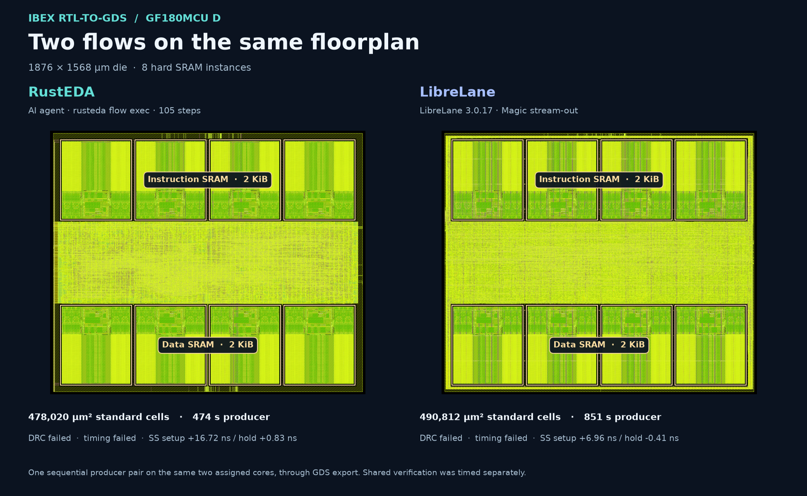
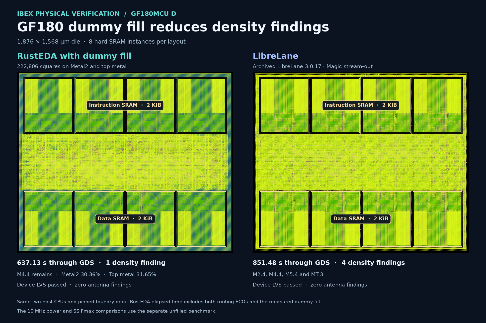
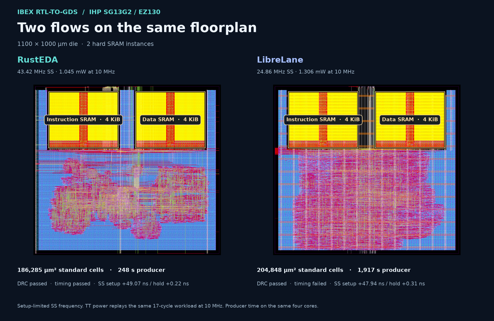
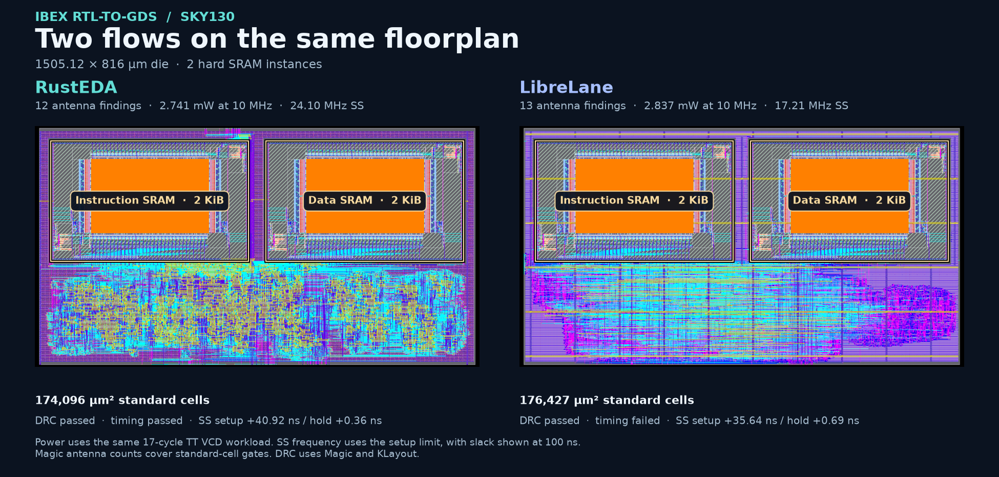

# Ibex RTL-to-GDS across three open PDKs

**IHP SG13G2 · SKY130 · GF180MCU.** RustEDA and LibreLane 3.0.17 implement
Ibex RV32IMC with separate instruction and data SRAM banks. Within each PDK,
both flows read the same RTL, 100 ns (10 MHz) constraints, macro views, die
area and macro placements, and are checked by the same independent signoff
scripts. (On SKY130A, RustEDA adds two 7 × 50 µm vertical placement blockages
that are not in LibreLane's configuration; see [fairness and known asymmetries](#comparison-fairness-and-known-asymmetries).)
Bank capacity and the cell library vary by PDK.

| Open PDK | Standard cells | Hard SRAM in each layout |
| --- | --- | --- |
| IHP SG13G2 | EZ130 8T | Two IHP 1,024 × 32 macros, one 4 KiB bank each |
| SKY130A | `sky130_fd_sc_hd` | Two OpenRAM 512 × 32 macros, one 2 KiB bank each. This macro configuration was included in the [UCSC OpenRAM MPW2 tape-out](https://escholarship.org/uc/item/9dc0v8g3). |
| GF180MCU D | `gf180mcu_fd_sc_mcu7t5v0` | Eight foundry 512 × 8 macros, four byte lanes per 2 KiB bank. [GlobalFoundries SRAM data sheet](https://gf180mcu-pdk.readthedocs.io/en/latest/IPs/SRAM/gf180mcu_fd_ip_sram/cells/gf180mcu_fd_ip_sram__sram512x8m8wm1/gf180mcu_fd_ip_sram__sram512x8m8wm1.html) |

## Power, area and timing margin

Each entry lists **RustEDA / LibreLane**. The QoR columns (power, area and SS
setup ceiling) measure each flow's **published layout** — the same layout timed
in the "published pair (1 run)" column. The last column gives the repeated
three-block median against the **screened LibreLane arm**, which on SKY130A and
GF180MCU D is a different layout (`drt-jumpers`) with substantially more
antenna violations and unmeasured QoR.

| PDK | TT 17-cycle workload power at 10 MHz (mW) | Standard-cell area (µm²) | SS setup ceiling at 10 MHz constraints (MHz)¹ | RTL to GDS, published pair, 1 run (s) | RTL to GDS, screened LibreLane arm, median of 3 (s)² |
|---|---:|---:|---:|---:|---:|
| IHP SG13G2 (4 cores) | **1.045** / 1.306 | **186,285** / 204,848 | **43.42** / 24.86 | **219.8** / 1,806.0 (8.22×) | **219.6** / 1,745.5 (**7.95×**; `antenna-default`, 0 / 0 phys.) |
| SKY130A (2 cores)³ | **2.741** / 2.837 | **174,096** / 176,427 | **24.10** / 17.21 | **1,660.6** / 1,730.6 (1.04×; 12 / 13 ant.) | 1,665.5 / **1,370.0** (0.82×; `drt-jumpers`, 12 / 105 ant.) |
| GF180MCU D (2 cores) | **91.24** / 94.33 | **475,913** / 490,812 | **10.91** / 10.75 | **594.1** / 911.0 (1.53×; 0 / 0 ant.) | **591.3** / 885.6 (**1.50×**; `drt-jumpers-fill`, 0 / 82 ant.) |

¹ **Not a tight-clock Fmax comparison:** both flows were given a relaxed **100 ns (10 MHz)** clock constraint, with LibreLane on `SYNTH_STRATEGY = "AREA 0"` and +35–49 ns of positive setup slack (so LibreLane's resizer performed zero setup optimization). These numbers are post-route SS setup-sweep ceilings on fixed netlists; on SKY130A RustEDA also excludes all `_1` drive-strength cells and applies five pre-bound critical-path OR-gate rewires.  
² In the 2026-11-18 campaign, the pre-registered Tier-3 fallback picked the fastest GDS when no LibreLane arm passed every physical gate, selecting `drt-jumpers` despite 105 Magic antenna findings on SKY130A and 82 on GF180MCU D. Neither flow passes every shared gate on SKY130A or GF180MCU D, so neither reaches a signoff endpoint there.  
³ **SKY130A RustEDA asymmetry:** RustEDA's `1,665.5 s` / `1,660.6 s` producer uses Ibex-trained PGO (`-231 s` on cold detailed routing alone), five distinct `.work` RustROAD binaries, two vertical placement channels not given to LibreLane, and five hardcoded OR-gate rewires; without PGO it runs slower than `librelane-recipe`. See [Comparison fairness and known asymmetries](#comparison-fairness-and-known-asymmetries).

Each pair uses the same homogeneous E-core CPU allocation and 4 GiB / zero-swap
envelope (4 cores on IHP, 2 cores on SKY130A and GF180MCU D). The GF180MCU D
producer includes floating fill on both flows; its timing and power use nominal
OpenRCX, whose extracted parasitics matched before and after DEF fill. The VCD
power column covers one 17-cycle smoke trace at 10 MHz (for vectorless 10 MHz
power on the aligned layouts, see [Aligned-select power trials](#aligned-select-power-trials):
1.21 / 5.57 mW on IHP, 6.56 / 9.50 mW on SKY130A and 79.80 / 139.09 mW on
GF180MCU D). One screening run of each published configuration is not a
confirmed three-block difference.
[Fairness audit](#comparison-fairness-and-known-asymmetries) ·
[IHP](#repeated-ihp-comparison-at-the-same-signoff) ·
[SKY130A](#repeated-sky130a-comparison-at-the-same-signoff) ·
[GF180MCU D](#repeated-gf180mcu-d-comparison-at-the-same-signoff)

[SKY130A native local repair](#sky130a-native-local-antenna-repair) ·
[Clean single-binary SKY130A (2026-11-20)](#clean-single-binary-sky130a-comparison-2026-11-20) ·
[Tight-clock Fmax comparison](tight-clock-fmax.md) ·
[Multi-design generalization](multi-design.md) ·
[IHP and GF180MCU D receipts](evidence/ibex-three-pdk/aligned-select-power-trials.json)

## Clean single-binary SKY130A comparison (2026-11-20)

To resolve the SKY130A fairness asymmetries documented below (Ibex-trained PGO,
five `.work` RustROAD binaries, two manual vertical placement channels, five
hardcoded OR-gate rewires, and OpenRCX/OpenSTA in the loop), we replaced the
archived `r02` producer with a clean, single-binary, non-PGO standard flow
(`integration/ibex_pdks/sky130hd/native/clean_sky130_flow.py`,
`profile-clean.json`, `physical-clean.json`, `routing-clean.json`) and ran a
fresh pre-registered **three-block counterbalanced (`AB / BA / AB`) quiet-host
confirmation** (`integration/paired_bench/plans/sky130-clean-single-binary.json`)
against `librelane-recipe` (the non-regressing baseline selected by
`no_physical_regression`) on the exact same 2 E-cores (`CPUs 30, 31`), 4 GiB /
zero-swap cgroup v2 scopes, with all 8 shared independent signoff gates running
on every sample.

Root cause of the speedup: the archived `physical.json` (`target_density_milli: 550`)
stalled electrostatic line search at iteration 14 / 200, creating the congestion
hotspot that previously forced two manual vertical channels and 1,215 s non-PGO
routing. Setting `target_density_milli: 400` converges all 200 iterations with
**zero manual vertical channels**, cutting peak pin density by 23.5% and HPWL by
8.1%, eliminating cold SS DRV violations automatically, and cutting cold non-PGO
detailed routing **5.0×** (`1,215 s → 242 s`). Adding `"met3": "0.40"` to
OpenRAM's `obstruction_spacing_um` clears all `met3.3d` DRCs cleanly.

| Metric (SKY130A Ibex, 2 E-cores, 4 GiB / 0 swap) | Archived PGO `r02` (2026-11-18) | **Clean single-binary non-PGO RustEDA (2026-11-20)** | LibreLane 3.0.17 `librelane-recipe` (2026-11-20) | Clean RustEDA vs LibreLane |
| --- | ---: | ---: | ---: | --- |
| PGO / `.work` binaries / manual channels / hardcoded rewires | Yes / 5 / 2 / 5 | **No / 0 / 0 / 0** (single standard release set) | Standard LibreLane 3.0.17 | **Clean parity** |
| **RTL to GDS, quiet-host median of 3 (s)** | 1,665.5 | **499.64** (`498.25–499.97`, spread 0.34%) | 1,771.75 (`1,765.98–1,774.10`, spread 0.46%) | **3.55× faster** (3.53–3.56×, 3/3 blocks) |
| Cross-block determinism (GDS / DEF / netlist) | Bit-exact | **Bit-exact** (3/3 identical) | **Identical** (`magic_prefix_masked_sha256` 3/3) | Both deterministic |
| Process Max RSS (MiB) | — | **631** | ~2,190 (cgroup peak 2,165–2,226) | **~3.5× less RAM** |
| Standard-cell area (µm²) / core util | 174,096 | **173,881** (28.30%) | 176,427 (28.72%) | **−1.4% smaller** |
| TT 10 MHz vectorless power (`paired-qor` method, mW) | 6.56 | **6.15** | 9.50 | **−35.3% lower** |
| SS setup ceiling (SDC sweep at 10 MHz, MHz) | 24.10 | **23.82** | 17.21 | **+38.4% higher** |
| Magic / KLayout DRC | 0 / 0 | **0 / 0** | 0 / 0 | Both 0 / 0 |
| Magic antenna violations | 12 | 14 (`met3: 10`, `met4: 1`, `via4: 3`) | **13** (`met1: 2`, `met3: 3`, `via4: 8`) | Both fail antenna gate |
| OpenRCX + OpenSTA TT / SS timing & DRV | Pass (0/0/0) | **Pass** (TT `0/0/0`, SS `0/0/0`) | **Fail** (TT `205/51/64`, SS `3,035/381/64`) | **RustEDA timing-clean** |
| Netgen LVS / Icarus sim / ABC equivalence | Pass / Pass / Pass | **Pass / Pass / Pass** (7/8 gates pass) | Pass / Pass / unverified (5/8 gates pass) | RustEDA formally proven |

[Clean SKY130A paired confirmation receipt](evidence/ibex-three-pdk/sky130-clean-single-binary.json) ·
[Paired benchmark plan](https://github.com/lab-emi/RustEDA/blob/main/integration/paired_bench/plans/sky130-clean-single-binary.json)

For tight-clock comparisons where both flows actively optimize setup timing
(IHP 25/20 ns, SKY130A 40 ns, GF180 65 ns), see
[Tight-clock Fmax comparison](tight-clock-fmax.md). For non-Ibex open-source
designs (`picorv32`, `aes_core`, `sha256_core`), see
[Multi-design generalization](multi-design.md).

## Comparison fairness and known asymmetries

The three PDKs are not equally fair comparisons. The measurement harness
(`integration/paired_bench/bench.py`) enforces strict hardware parity
(homogeneous non-SMT 3.9 GHz E-cores, 4 GiB / 0 swap cgroup scopes, quiet-host
gates, counterbalanced AB/BA/AB blocks and shared external signoff tools),
yielding under 1% spread across blocks. However, an audit of the underlying
producers and configurations exposes substantial asymmetries in **both**
directions — sharpest on SKY130A and mildest on IHP SG13G2:

| PDK | Overall parity | Main biases favoring LibreLane / hurting RustEDA | Main biases favoring RustEDA / hurting LibreLane |
| --- | --- | --- | --- |
| **IHP SG13G2** | Cleanest (single standard `rusteda flow exec`, 9/9 gates pass) | None on runtime; LibreLane fails electrical timing gate | LibreLane's timed GDS window includes `OpenROAD.IRDropReport` (28.6 s), redundant `Magic.StreamOut` (23.7 s) before `KLayout.StreamOut` and 6× OpenSTA (226 s); Fmax swept from 10 MHz `AREA 0` run |
| **GF180MCU D** | Moderate (no PGO, no hardcoded ECOs) | Legacy Tier-3 rule picked `drt-jumpers-fill` (82 antenna, 7 SS hold) over `recipe-fill` (0 antenna; 1.53×); RustEDA pays ~34 s of in-flow ABC proofs inside GDS time | RustEDA runs via a `.work` wrapper invoking OpenRCX + OpenSTA twice internally (~54 s) for post-route hold/load ECOs; `floating_fill.py` fits RustEDA's PDN geometry better (31.65% vs 26.03% top metal); LibreLane includes IR drop (23.6 s) and 6× OpenSTA (104 s) |
| **SKY130A (archived 2026-11-18 `r02`)** | Lowest (strong bidirectional asymmetry; superseded by the [clean single-binary 2026-11-20 confirmation](#clean-single-binary-sky130a-comparison-2026-11-20) above) | Legacy Tier-3 rule picked `drt-jumpers` (105 Magic antenna, 2,953 SS slew) over `recipe` (13 antenna) and mixed its time with `recipe` QoR; RustEDA pays ~32 s of serial in-flow ABC proofs | **Ibex-trained PGO** on cold and staged RustROAD (`-231 s` on cold `be_route` alone: 1,214.9 → 983.9 s — without PGO, RustEDA is ~1,892 s, slower than `librelane-recipe`); **5 distinct `.work` RustROAD binaries**; **2 vertical placement blockages** (`x = 507–514, 526–533 µm`) absent from LibreLane (`FP_OBSTRUCTIONS: null`); **5 offline-discovered hardcoded OR-gate pin rewires** (`g2826/27/29`); 16-decimal Magic-calibrated thresholds; exclusion of all `_1` cells; 2 internal OpenRCX/OpenSTA feedback loops |

Additional cross-PDK scope limits:

- **Selection rule fix (harness updated after the 2026-11-18 runs):** `bench.py`
  now defaults Tier-3 fallback (when no arm passes all physical gates) to
  `no_physical_regression`, rejecting any arm that regresses a physical gate or
  increases DRC/antenna counts relative to `baseline_arm`. Under this rule, the
  existing screening data would select `librelane-recipe` on SKY130A (13
  antenna) and `librelane-recipe-fill` on GF180MCU D (0 antenna) instead of
  `drt-jumpers`. The archived 2026-11-18 plan files and receipts remain
  unmodified as historical evidence.
- **Magic random sub-cell prefix fix (harness updated):** `bench.py` now records
  `magic_prefix_masked_sha256` alongside `dates_masked_sha256`, canonicalizing
  Magic's per-run two-character macro sub-cell prefix (e.g., `FF_` / `JE_` /
  `M4_` across all 160 OpenRAM sub-cells) without masking ordinary library cell
  prefixes (`RM_...`, `M1_...`). Verified on all four SKY130A `drt-jumpers`
  GDS streams, which now hash identically (`b9f69b5567fc…`).
- **Limited LibreLane tuning space:** The screening plans varied only four
  antenna and post-GRT resizer knobs, not `SYNTH_STRATEGY`, placement density,
  `RUN_IRDROP_REPORT`, or placement obstructions, whereas RustEDA underwent
  multi-day tuning across synthesis, floorplan, routing and repair.
- **No post-hoc SKY130A `librelane-recipe` rerun against `r02`:** We deliberately
  did not run a 6–7 hour post-hoc three-block confirmation of `librelane-recipe`
  against the archived SKY130A `r02` producer. Confirming a ~1.04× edge post-hoc
  while `r02` depends on Ibex-trained PGO (`-231 s`), five `.work` binaries,
  extra placement channels and hardcoded rewires would not establish a clean
  speedup. Instead, we consolidated RustEDA into a single standard non-PGO
  release flow and ran a fresh pre-registered three-block confirmation on
  2026-11-20 (see [Clean single-binary SKY130A comparison](#clean-single-binary-sky130a-comparison-2026-11-20)
  above: **499.64 s vs 1,771.75 s, 3.55×**).
- **Pinned layout figures:** The side-by-side GDS PNGs on this page are
  SHA-256 pinned in their original receipts (`aligned-select-power-trials.json`
  and `sky130-native-local-repair.json`) and therefore retain their original
  published single-run text captions (for example, `248 s / 1,917 s` on IHP and
  `637.13 s / 851.48 s` on GF180MCU D without LibreLane fill). Use the summary
  tables above for the repeated three-block timings and updated caveats.

### Earlier vectorless results

Each cell lists **RustEDA / LibreLane** for the GDS pair shown on this page.
Every power estimate uses **10 MHz (100 ns) for both flows** on all three
processes. Percentages show RustEDA's change relative to LibreLane.

| Open PDK | TT modeled power at 10 MHz for both (mW) | Standard-cell area (µm²) | SS setup Fmax (MHz) |
| --- | ---: | ---: | ---: |
| IHP SG13G2 | 8.63 / 5.57 (+54.9%) | 187,585 / 204,848 (**−8.4%**) | 42.02 / 24.86 (**+69.0%**) |
| SKY130A | 28.99 / 9.50 (+205.2%) | 176,089 / 176,427 (**−0.19%**) | 23.75 / 17.21 (**+37.9%**) |
| GF180MCU D | 155.89 / 139.09 (+12.1%) | 478,020 / 490,812 (**−2.6%**) | 12.01 / 10.75 (**+11.7%**) |

Power is the sum of internal, switching and leakage power reported by OpenSTA
3.1.0 on the linked post-route netlist. Each pair uses the same TT cell and
SRAM Liberty, nominal OpenRCX SPEF for each layout and its original propagated
10 MHz clock. Vectorless propagation starts at the non-clock data inputs
with 0.10 transitions per cycle and a duty factor of 0.5. The active-low reset
is held high. All six layouts had full parasitic annotation on active drivers.
[OpenSTA power analysis](https://github.com/The-OpenROAD-Project/OpenSTA/blob/master/doc/Examples.md#power-analysis)

The estimates include the SRAM models' internal and leakage terms. The SKY130
Liberty charges clock energy on both SRAM ports, including the unused read
port. The GF180 macro tables model read, write and disabled states. Enabled
writes with all bits masked fall outside those tables.

To find setup Fmax, OpenSTA swept the single `clk_i` period at SS on the fixed
netlists, using nominal extracted parasitics, propagated clocks and the
original fixed I/O delays. The sweep brackets the transition to nonnegative
setup slack within 0.005 ns for every layout. The table reports the reciprocal
of the shortest passing period observed, including timed I/O and clock-gating
paths. The hold, electrical and physical check outcomes appear with each
layout below. Area uses the standard-cell footprint, excluding SRAM, gap
fillers and decap cells, within the same die.
[Paired QoR receipt](evidence/ibex-three-pdk/paired-qor.json)

## Repeated IHP comparison at the same signoff

The published IHP pair was one sample of each flow (248.07 / 1,917.16 s),
timed to GDS, with LibreLane's published recipe. This comparison changes three
things. LibreLane first gets a screen of tuning arms. Every sample then runs
the shared gates on its own layout within the measurement. Finally, the selected
LibreLane arm and RustEDA alternate over three blocks.

Every sample used CPUs 24–27 with 4 GiB and no swap, and started after the
host had been idle for a minute. The gates ran right after each producer, in
a second scope with the same limits.
[Harness, plan and selection rule](../../integration/paired_bench/README.md)

LibreLane kept its temporary files on the home volume, as in the published
IHP run. That setting stalled Yosys 0.70 on GF180MCU D (below), but not
IHP's Yosys 0.62. In a control run, moving them to `/tmp` changed synthesis
time by under 0.5 s: 131.8–132.4 s on the home volume, 131.5–132.0 s on
`/tmp`, with the same netlist each time.
[TMPDIR control](evidence/ibex-three-pdk/ihp-tmpdir-synthesis.json)

### LibreLane tuning screen

The rule fixed before the first sample selects the arm with the shortest
time through every shared gate except logic equivalence. If no arm passes
them, it selects the fastest GDS among arms that pass DRC, antenna, latch-up
and LVS.

| LibreLane arm | To GDS (s) | To DRC, antenna, latch-up and LVS (s) | TT slew / capacitance / fanout findings |
|---|---:|---:|---:|
| Published recipe, antenna margin 50 | 1,806.0 | 2,527.8 | 1 / 29 / 33 |
| **Default antenna repair**, margin 10 | **1,747.4** | **2,473.4** | 1 / 29 / 33 |
| Default antenna repair and resizer margins | 1,875.6 | 2,598.8 | 1 / 29 / 38 |
| Jumpers instead of diodes after routing | 1,424.0 | 240 antenna findings | 1 / 29 / 4 |
| *RustEDA* | *219.8* | *754.3* | *0 / 0 / 0* |

Setup and hold pass on every layout. The recipe arm reproduced the published
LibreLane DEF and netlists byte for byte, and its GDS after masking dates.
The antenna margin did not change the routed repair: margins 10 and 50 both
inserted 409, 66 and 15 diodes in the first three passes. The default margin
stops one pass earlier and saves about 60 s.

Every arm fails the timing gate on electrical limits. Thirty-one of the 33
fanout findings are on nets that carry those diodes, up to 21 on one buffer
output. Twenty of the 29 capacitance findings are on nets without diodes.
LibreLane's classic flow has no electrical repair after detailed routing.
Repairing with jumpers instead added none after routing and left 240 antenna
findings. The rule therefore selected default antenna repair.

The jumper arm was added after the first sample by a recorded plan
amendment that may only add arms. A harness error stopped the first RustEDA
sample before its first step. That sample was moved aside with its reason
and rerun.

### Confirmation blocks

The selected arm and RustEDA then ran three blocks in the order AB, BA, AB.
No sample used swap or recorded foreign load on its CPUs. Each flow produced
identical outputs in every run; LibreLane's GDS matched after masking dates.

| Endpoint | RustEDA (s) | LibreLane (s) | Ratio | Lowest to highest ratio |
|---|---:|---:|---:|---:|
| GDS | **219.6** (219.6–219.7) | 1,745.5 (1,743.7–1,745.9) | **7.95×** | 7.94–7.95× |
| DRC, antenna, latch-up and LVS | **754.2** (754.2–756.0) | 2,467.7 (2,465.2–2,471.9) | **3.27×** | 3.26–3.28× |
| Every gate except logic equivalence | **783.2** (783.0–785.0) | not reached | | |
| Every gate | **800.5** (800.3–802.3) | not reached | | |

Each cell shows the median and the range of three runs. The ratio divides the
LibreLane median by the RustEDA median. The lowest ratio divides the fastest
LibreLane run by the slowest RustEDA run. Every LibreLane run was slower than
every RustEDA run at both endpoints LibreLane reached.

The shared gates add about 535 s to RustEDA's time and 722 s to LibreLane's.
The physical-gate ratio is therefore well below the GDS ratio. LibreLane does
not reach the last two endpoints: every run fails the timing gate on the
electrical limits above. The logic checker cannot judge its netlists either.
Yosys renames 431 registers and merges duplicated ones, and the checker needs
a unique named counterpart for each register before it starts a proof. This
is a limit of the checker, not evidence against LibreLane's netlist.
[Samples, selection and verdicts](evidence/ibex-three-pdk/ihp-repeated-signoff.json) ·
[Plan before the amendment](evidence/ibex-three-pdk/ihp-repeated-signoff-plan-v1.json)

These are three runs of one design on one host. They show that the IHP lead
is stable under the same limits and gates. They do not measure other designs
or other CPU allocations.

## Repeated SKY130A comparison at the same signoff

The published SKY130A pair was one sample of each flow (1,675.78 /
1,771.63 s), timed to GDS. This comparison applies the IHP protocol on
CPUs 30–31 with 4 GiB and no swap. The gates are Magic and KLayout DRC, Magic antenna,
Netgen LVS, OpenRCX extraction, TT and SS timing, Icarus simulation, density
and logic equivalence. Magic's antenna check alone took 1,354–1,967 s per
layout.

The RustEDA arm reruns the published producer from copies of the inputs it
had at launch. Only the six lines that located its own directory changed.
Every run reproduced the published GDS, DEF and netlists byte for byte.
[Port receipt](evidence/ibex-three-pdk/sky130-port-reproduction.json)

### SKY130A LibreLane tuning screen

As on GF180MCU D, the published configuration already uses LibreLane's
defaults for the knobs screened on IHP, so this screen tries the IHP
recipe's closure settings and jumper-only repair. The selection rule is the
IHP rule.

| LibreLane arm | To GDS (s) | Magic antenna findings | TT slew / capacitance / fanout findings |
|---|---:|---:|---:|
| Published configuration | 1,730.6 | 13 | 203 / 27 / 64 |
| IHP antenna repair, margin 50 | 2,312.5 | 8 | 424 / 32 / 250 |
| IHP antenna repair and resizer margins | 2,299.3 | 8 | 424 / 32 / 250 |
| **Jumpers instead of diodes after routing** | **1,371.4** | 105 | 221 / 31 / 34 |
| *RustEDA* | *1,660.6* | *12* | *0 / 0 / 0* |

DRC, LVS, simulation, setup and hold pass on every layout. RustEDA's layout
passes every timing row at TT and SS and the logic gate. Every LibreLane
layout fails the timing gate on electrical limits, with 2,953–3,661 SS slew
findings, and the logic checker cannot judge its netlists.

Antenna repair at margin 50 cut Magic's findings from 13 to 8 and added
about 580 s. The resizer margins changed nothing: both IHP-closure arms
produced the same DEF and netlists. Every layout keeps Magic antenna
findings, so no arm passes the physical gates, and the rule selected the
fastest GDS. Jumper-only repair was 359 s faster than the published
configuration, with 105 antenna findings instead of 13. That choice favours
LibreLane's time. The published configuration reproduced the published
LibreLane DEF and netlists byte for byte.

### SKY130A confirmation blocks

The selected arm and RustEDA then ran three blocks in the order AB, BA, AB.
No sample used swap or recorded foreign load on its CPUs. RustEDA produced
the same GDS, DEF and netlists in every run. LibreLane produced the same DEF
and netlists. Its GDS also matched across all three confirmation blocks (and
`screen-05`) after masking dates and Magic's random two-character prefix on
the SRAM macro's 160 sub-cells (`bench.py` now computes this directly via
`magic_prefix_masked_sha256`).

| Endpoint | RustEDA (s) | LibreLane (s) | Ratio | Lowest to highest ratio |
|---|---:|---:|---:|---:|
| GDS | 1,665.5 (1,659.7–1,673.9) | **1,370.0** (1,370.0–1,370.7) | **0.82×** | 0.82–0.83× |
| DRC, antenna and LVS | not reached | not reached | | |
| Every gate except logic equivalence | not reached | not reached | | |
| Every gate | not reached | not reached | | |

The selected LibreLane arm reached GDS first in every block; RustEDA took
1.22 times as long. Neither flow reaches a signoff endpoint, because Magic's
antenna check fails both: 12 findings on RustEDA's layout and 105 on
LibreLane's. RustEDA's layout passes every other gate. LibreLane's also fails
the timing gate (TT 221 / 31 / 34, SS 2,953 / 352 / 34 slew, capacitance and
fanout findings). The published LibreLane configuration, with 13 antenna
findings, took 1,730.6 s in its single screening run against RustEDA's
1,660.6 s; one run of each is not a confirmed difference. Under the updated
`no_physical_regression` Tier-3 rule in `bench.py`, `librelane-recipe` would
have been selected over `librelane-drt-jumpers`. Because RustEDA's current
SKY130A `r02` producer relies on Ibex-trained PGO (`-231 s` on cold detailed
routing), five `.work` RustROAD binaries, two vertical placement channels and
five pre-bound OR-gate rewires, no post-hoc confirmation against
`librelane-recipe` was added; see
[Comparison fairness and known asymmetries](#comparison-fairness-and-known-asymmetries).
[Samples, selection and verdicts](evidence/ibex-three-pdk/sky130-repeated-signoff.json)

## Repeated GF180MCU D comparison at the same signoff

The published GF180MCU D pair was one sample of each flow (637.13 /
851.48 s), and only RustEDA's included floating fill. This comparison
applies the IHP protocol on CPUs 22–23 with 4 GiB and no swap. Every LibreLane arm now
ends in the fill emitter that RustEDA runs, applied to its own final GDS
inside the timed producer, so both flows are judged on density with fill.
The emitter lifts LibreLane's top metal only to 26 % of the die, below its
30 % target, then emits what fits and leaves the verdict to the foundry
density rules. The fill is GDS geometry only: OpenRCX, the timing gate and
the power figures do not see it.

The RustEDA arm reruns the published producer from copies of its launch
inputs, with the tracked emitter in place of the scratch fill scripts. Every
run reproduced the published DEF and netlists byte for byte, and its GDS
after masking dates.
[Port receipt](evidence/ibex-three-pdk/gf180-port-reproduction.json)

### GF180MCU D LibreLane tuning screen

The published GF180MCU D configuration already uses LibreLane's defaults for
the knobs screened on IHP, so this screen tries the IHP recipe's closure
settings and jumper-only repair instead. The selection rule is the IHP rule.

| LibreLane arm, with fill | To GDS (s) | Density findings | Antenna findings | TT slew / capacitance / fanout findings | SS hold violations |
|---|---:|---:|---:|---:|---:|
| Published configuration | 911.0 | 3 | 0 | 31 / 11 / 0 | 7 |
| IHP antenna repair, margin 50 | 1,029.1 | 3 | 0 | 21 / 9 / 2 | 10 |
| IHP antenna repair and resizer margins | 1,041.1 | 3 | 0 | 26 / 10 / 1 | 8 |
| **Jumpers instead of diodes after routing** | **887.9** | 3 | 82 | 31 / 11 / 0 | 7 |
| *RustEDA* | *594.1* | *1* | *0* | *20 / 1 / 0* | *0* |

Setup, LVS and simulation pass on every layout. Every LibreLane layout keeps
whole-die coverage findings on Metal4, Metal5 and the top metal (M4.4, M5.4,
MT.3). RustEDA's keeps one, on Metal4, a layer the emitter does not fill. No
arm passes the physical gates, so the 2026-11-18 rule selected the fastest GDS:
jumper-only repair, 23 s faster than the published configuration but with 82
antenna findings. That choice favours LibreLane's time; under the updated
`no_physical_regression` Tier-3 rule in `bench.py`, `librelane-recipe-fill`
(0 antenna findings, 911.0 s) would be selected instead. The published
configuration reproduced the published LibreLane DEF and netlists byte for
byte.

The first attempt of the first sample stopped in Yosys synthesis. With
temporary files on the home volume instead of `/tmp`, Yosys 0.70's parallel
ABC mapping waited indefinitely in three of three runs. The campaign
restarted with `/tmp`, as in the published runs, which reproduces the
published synthesis netlist.
[Hang receipt](evidence/ibex-three-pdk/gf180-yosys-tmpdir-incident.json)

### GF180MCU D confirmation blocks

The selected arm and RustEDA then ran three blocks in the order AB, BA, AB.
No sample used swap or recorded foreign load on its CPUs. Each flow produced
the same DEF and netlists in every run, and the same GDS after masking dates.

| Endpoint | RustEDA (s) | LibreLane (s) | Ratio | Lowest to highest ratio |
|---|---:|---:|---:|---:|
| GDS with fill | **591.3** (590.6–592.4) | 885.6 (884.7–889.3) | **1.50×** | 1.49–1.51× |
| DRC, antenna and LVS | not reached | not reached | | |
| Every gate except logic equivalence | not reached | not reached | | |
| Every gate | not reached | not reached | | |

Neither flow reaches a signoff endpoint, so only the GDS ratio is reported.
RustEDA misses the physical gates on its Metal4 coverage finding, and the
timing gate on 20 TT and 39 SS slew findings and one capacitance finding.
LibreLane misses them on three coverage and 82 antenna findings, and on the
electrical findings above and seven SS hold violations. The logic gate passed
on RustEDA's netlists and cannot judge LibreLane's, as on IHP.

Fill took 62.1–62.9 s of each RustEDA run and 68.8–69.1 s of each LibreLane
run. Without it, LibreLane took 815.7–820.4 s, less than the published
851.5 s sample, which ran while about four CPUs elsewhere on the host were
busy.
[Samples, selection and verdicts](evidence/ibex-three-pdk/gf180-repeated-signoff.json)

## IHP SG13G2 layout pair

The figure shows the retained 10 November layout pair. RustEDA used 8.4% less
standard-cell footprint and had 1.51 ns more slow-corner setup slack. LibreLane
had 0.10 ns more slow-corner hold slack. Both layouts passed DRC, antenna and
LVS in that run. RustEDA passed the shared timing gate and LibreLane failed it.
The producer times in the figure are single measurements under competing host
load. The later IHP campaign has its own timing and artifact receipts.
[Figure receipt](evidence/ibex-three-pdk/ihp-20261110-layouts.json) ·
[13 November IHP campaign](../benchmarks.md#ibex-host-campaign-2026-11-13)

## SKY130A layout pair

RustEDA completed all 105 steps on a 1,505.12 × 816 µm die. The two flows
placed both OpenRAM banks at the same locations, and the independent GDS
check matched each macro to the source geometry on every layer. The native
profile uses a 29.44 µm staggered tap lattice and explicit clearance at the
SRAM routing obstructions.

| SKY130A measurement | RustEDA | LibreLane |
| --- | ---: | ---: |
| Standard-cell footprint | 176,088.9 µm² | 176,426.7 µm² |
| Slow-corner setup slack | +40.59 ns | +35.64 ns |
| Slow-corner hold slack | +0.49 ns | +0.69 ns |
| Slow-corner transition / capacitance / fanout violations | 21 / 3 / 0 | 3,026 / 357 / 64 |
| Observed producer wall time through GDS, same two cores | 1,241.0 s | 1,771.6 s |
| Observed producer wall time through GDS, same four cores | 1,173.71 s | 1,173.80 s |

Both layouts passed shared simulation and LVS. RustEDA passed external ABC
equivalence on the mapped and final netlists. Both layouts have residual
electrical-limit violations. The RustEDA typical corner is clean under the
shared timing check. Both layouts passed Magic and KLayout DRC, including
the tap-distance checks. The independent Magic antenna check found 211
violations for RustEDA and 13 for LibreLane.

The two-core pair ran sequentially on the same physical cores, with 4 GiB and
zero swap per producer. RustEDA used 30.0% less wall time. The four-core runs
allowed 4 GiB for RustEDA and 8 GiB for LibreLane. Both peaked below 2.4 GiB
and used zero swap. The RustEDA replays reproduced the checked GDS, DEF,
netlists and SPEF byte for byte.
The timed LibreLane DEF and netlists also match the checked files byte for byte.
Its GDS streams differ in dates and names of generated internal structures,
with all geometry and references preserved.
[RustEDA layout and replay receipt](evidence/ibex-three-pdk/physical-iterations.json) ·
[Producer replays](evidence/ibex-three-pdk/sky130-gds-producer-samples.json) ·
[LibreLane receipt](evidence/ibex-three-pdk/sky130-reference-layout.json)

RustEDA's earlier same-core replay took 1,625.9 s, including 1,566.6 s for
detailed routing. Finer obstacle bins, scalar target costs and SRAM-edge
clearance reduced the routing stage to 1,186.3 s. Reusing per-layer target
costs and the rail-tie lookup reduced it to 1,163.8 s. Heap and instance
lookup changes brought routing to 1,129.0 s. Reusing visited-state records
brought it to 1,115.1 s. The four-core producer measurements are effectively
tied at a difference of 0.09 s.
[Earlier run and optimization receipts](evidence/ibex-three-pdk/physical-iterations.json)

An incremental repair of the earlier layout applied the SRAM-edge clearances.
RustEDA kept 15,362 of 15,388 routed nets and finished routing in 30.6 s from
a placed revision. Magic reported zero DRC violations on the exported GDS.
After three further jumper passes, Magic reported 120 antenna violations and
zero DRC violations on the follow-up GDS.
[Incremental layout and checks](evidence/ibex-three-pdk/physical-iterations.json)

A separate seeded ECO inserted 108 antenna diodes. Magic reported 154 antenna
violations on the resulting GDS. Both DRC decks, LVS and ABC equivalence
passed, with a standard-cell footprint of 176,359.1 µm².
[Diode ECO layout and checks](evidence/ibex-three-pdk/physical-iterations.json)

SKY130 uses the OpenRAM macro's typical-corner Liberty at both corners. Both
producers and the shared timing check use the same derived copy with three
input transition limits removed. GF180MCU uses the foundry macro's TT and SS
models. [Inputs and PDK provenance](../../integration/ibex_pdks/README.md)

## GF180MCU D layout pair

RustEDA's agent-run manifest completed 105 steps through GDS export. Both
layouts use the same 1,876 × 1,568 µm die and the same placed SRAM macros.
The independent GDS comparison matched all eight instances to the foundry
geometry on every layer.

| GF180MCU D measurement | RustEDA | LibreLane |
| --- | ---: | ---: |
| Standard-cell footprint | 478,020.2 µm² | 490,811.6 µm² |
| Slow-corner setup slack at a 100 ns clock | +16.72 ns | +6.96 ns |
| Slow-corner hold slack | +0.83 ns | −0.41 ns |
| Slow-corner hold violations | 0 | 7 |
| Slow-corner transition / capacitance violations | 66 / 17 | 39 / 12 |
| Observed producer wall time through GDS, same two cores | 474.4 s | 851.5 s |

Both layouts passed shared LVS, simulation and antenna checks. The antenna
deck found 51 violations after 45 diodes were removed in a reference control.
Shared timing failed on both layouts. The foundry DRC reported the same four
whole-die metal-density findings on each layout. External ABC proved RustEDA's
synthesis and final netlists equivalent to the prepared
RTL at the functional SRAM interfaces. The reference equivalence check reached
an incomplete state correspondence. LibreLane and RustEDA ran sequentially
on the same two 3.9 GHz cores. The RustEDA replay reproduced the GDS, DEF,
netlists and native SPEF byte for byte. The LibreLane replay reproduced the
DEF and netlists byte for byte, and the GDS differed only in date records.
A later RustEDA replay with the routing search optimizations finished in
395.4 s on the same two cores and reproduced all six artifacts byte for byte.
[Paired producer receipt](evidence/ibex-three-pdk/gf180-gds-producer-pair.json) ·
[RustEDA receipt](evidence/ibex-three-pdk/gf180-native-layout.json) ·
[LibreLane receipt](evidence/ibex-three-pdk/gf180-reference-layout.json)

## GF180MCU D routed-load feedback

The hold-stage ECO used measured loads on 17 nets from the earlier RustEDA
layout. The fresh 105-step run produced a layout using 478,393.4 µm²,
2.53% below LibreLane. Slow-corner transition and capacitance violations
fell to 30 and 4. Setup and hold slack are +16.10 and +0.70 ns.
LVS, simulation, external ABC equivalence and antenna passed. DRC reported
four whole-die metal-density violations. Feedback generation uses a prior
routed layout and falls outside the paired producer measurement above.
[Layout and checks](evidence/ibex-three-pdk/physical-iterations.json)

## Aligned-select power trials

RustSys can decode dynamic selections whose candidate bit windows are
disjoint. The native profile enables this with `synthesis.aligned_selects`.
The paired trials retain the original RTL inputs, hard SRAM and SDC. Each
cell lists **the RustEDA trial / LibreLane**.

| Routed trial | Modeled power at 10 MHz (mW) | SS setup Fmax (MHz) | Standard-cell area (µm²) |
| --- | ---: | ---: | ---: |
| GF180MCU D, aligned selects and area goal | 79.77 / 139.09 | 10.89 / 10.75 | 475,360 / 490,812 |
| GF180MCU D, aligned selects and area goal, with hold and load repair | 79.80 / 139.09 | 10.91 / 10.75 | 475,913 / 490,812 |
| GF180MCU D, aligned selects and delay goal, with antenna repair | 92.34 / 139.09 | 15.04 / 10.75 | 571,373 / 490,812 |
| IHP SG13G2, aligned selects with reset specialization | 1.50 / 5.57 | 40.44 / 24.86 | 176,104 / 204,848 |
| IHP SG13G2, aligned selects with arbitrary initial state | 1.21 / 5.57 | 43.42 / 24.86 | 186,285 / 204,848 |
| SKY130A, aligned selects and two vertical placement channels | 6.54 / 9.50 | 23.07 / 17.21 | 173,080 / 176,427 |
| SKY130A, dual channels with electrical repair and OR-path rebalance | 6.57 / 9.50 | 24.02 / 17.21 | 173,174 / 176,427 |
| SKY130A, dual channels with targeted antenna and capacitance repair | 6.56 / 9.50 | 24.01 / 17.21 | 173,533 / 176,427 |

The GF180 delay goal and aligned selects reduce the vectorless power estimate
by 40.8% and raise setup Fmax by 25.2% relative to the original RustEDA layout.
Use `synthesis.goal = "delay"` and `synthesis.aligned_selects = true` in a
copy of the native GF180 profile to select this mapping policy. The source
port replayed all 105 steps and reproduced the cold trial's GDS, DEF,
three netlists, SPEF and routing table byte for byte. The warm physical
trial added two antenna jumpers. Its final netlists passed ABC equivalence,
and shared LVS, simulation and antenna checks passed. The foundry DRC
reported the same four density findings as the original GF180 pair. At the
shortest passing SS period of 66.503125 ns, setup and hold slack are
nonnegative at TT and SS.
The trial retains electrical-limit findings and uses 16.4% more standard-cell
area than LibreLane. The area-goal variant uses less area and has two TT hold
violations. [Trial receipts](evidence/ibex-three-pdk/aligned-select-power-trials.json)

The repaired GF180 area-goal layout closes setup and hold at TT and SS.
TT transition/capacitance counts are 20/1 versus LibreLane's 31/11, and SS
counts are 39/1 versus 39/12. Both layouts have the same four foundry density
findings. From RTL to the exact final GDS, the RustEDA replay used 539.54 s,
including both corrections and their prerequisite extractions and logic
checks. LibreLane used 851.48 s on the same CPU pair. Final signoff ran
outside the producer timings. [Replay and layout identities](evidence/ibex-three-pdk/aligned-select-power-trials.json)

A separate GF180 physical trial adds 2 × 2 µm floating fill to Metal2 and
Metal5/top while preserving all routed conductors, instances and macro geometry.
The full foundry deck reports one finding, M4.4. Antenna, device LVS, vendor
simulation and ABC passed. The OpenRCX control emitted identical SPEF with and
without explicit `FILLS` geometry. Power and Fmax in the table use the unfilled
routed layout. [Fill geometry, DRC and extraction control](evidence/ibex-three-pdk/aligned-select-power-trials.json)

On CPUs 22 and 23, the complete RustEDA producer including both ECOs and
floating fill took **637.13 s**. LibreLane took **851.48 s** on the same CPU
pair with 4 GiB of memory and no swap. Both output streams matched the checked
GDS geometry after masking timestamps. Three alternating runs with the same
fill on LibreLane's layout are in the
[repeated GF180MCU D comparison](#repeated-gf180mcu-d-comparison-at-the-same-signoff).
[Filled producer replay](evidence/ibex-three-pdk/aligned-select-power-trials.json)

The opt-in `integration/ibex_pdks/gf180mcu/native/floating_fill.py` emitter
reproduces the checked filled geometry from the routed GDS, DEF and SRAM LEF.
It reports the selected fill phases and source hashes in JSON.

The IHP trial uses the earlier aligned-select and after-reset compiler recipe.
Its synthesis and final netlists passed equivalence after asserted reset,
and the shared vendor-model simulation passed. Its setup ceiling is above
LibreLane's 24.86 MHz and below the original RustEDA layout's 42.02 MHz.
An arbitrary-initial-state replay uses path-aware pin access and omits the
optional via reduction pass. Its routed layout passed external ABC on the
synthesis and final netlists, with all functional SRAM interface bits
covered. Independent extraction, timing, simulation, density, foundry DRC,
antenna, latch-up and device LVS checks passed. [Layout and check identities](evidence/ibex-three-pdk/aligned-select-power-trials.json)

Select the qualified opt-in recipe with
`--profile integration/ibex_pdks/ihp_sg13g2_ez130/native/profile-aligned-power.json`.
The current composer and ported RustSys reproduced its six sealed artifacts.

The IHP arbitrary-initial-state comparison uses fresh RTL-to-GDS runs on the
same four assigned cores with 4 GiB of memory and no swap. RustEDA took
**248.07 s** and LibreLane took **1,917.16 s**, a **7.73×** elapsed-time ratio.
Both ran while other jobs kept five to seven CPUs busy elsewhere on the host. The
[repeated comparison](#repeated-ihp-comparison-at-the-same-signoff) on an
idle host measured 7.95× to GDS and 3.27× through the physical gates.
RustEDA reproduced all six archived outputs byte for byte. LibreLane reproduced
the DEF and both netlists byte for byte, and all 2,024,006 GDS records matched
after masking 243 date payloads. The independent gates ran outside both producer
intervals. [Matched replay identities](evidence/ibex-three-pdk/aligned-select-power-trials.json)

For a matching 17-cycle gate-level smoke workload at 10 MHz, the
VCD-annotated TT estimates are **92.64 / 94.33 mW** on the repaired GF180
delay-goal pair and **1.001 / 1.306 mW** on the after-reset IHP pair.
The repaired GF180 area-goal pair measures **91.24 / 94.33 mW** and the
arbitrary-initial-state IHP pair measures **1.045 / 1.306 mW**. The original
RustEDA layouts estimate 92.36 mW and 1.081 mW on those respective
workloads. Input traces and valid-output traces match within each pair.
[Waveform identities and activity coverage](evidence/ibex-three-pdk/aligned-select-power-trials.json)

The SKY130 dual-channel trial leaves two signal-free vertical placement
strips and keeps the original die, ports, and SRAM macro positions. Its final
GDS passed independent extraction, device LVS, vendor simulation, ABC
equivalence, placement density, and both Magic and KLayout DRC checks. The matched 17-cycle workload at 10 MHz
estimates **2.739 / 2.837 mW**. Both TT and SS have nonnegative setup and hold
slack at the shortest tested passing SS period of 43.346250 ns. At 10 MHz,
the dual layout has 83 SS transition and 11 SS capacitance violations.
On CPUs 30 and 31 with 4 GiB and no swap, the dual-channel RTL-to-GDS
producer took **1,283.14 s** against LibreLane's **1,771.63 s**. The replay
reproduced the native GDS, DEF, three netlists and SPEF byte for byte. Magic
reported 219 antenna findings for this layout and 13 for the LibreLane reference.
To select the frozen placement policy, use
`--profile integration/ibex_pdks/sky130hd/native/profile-aligned-dual-channel.json`
with RustROAD containing the disjoint row-blockage fix `9028a2f`.
[Exact trial inputs and checks](evidence/ibex-three-pdk/aligned-select-power-trials.json)

Eleven measured-capacitance buffers and a five-pin OR-path rebalance form a
separate warm-routed GDS. Extraction, LVS, vendor simulation, ABC equivalence
and placement density passed. Both independent DRC decks report zero violations.
The 17-cycle workload estimates **2.740 / 2.837 mW**,
and TT and SS setup and hold are nonnegative at 41.636250 ns. The SS electrical
rows fell to 16 transition and two capacitance violations. The warm producer
was separately observed in 137.69 s on CPUs 8 and 10. One elapsed replay through
cold production, ECO prerequisites, the warm reroute and final GDS took
**1,483.81 s** against LibreLane's **1,771.63 s** on CPUs 30 and 31 with
4 GiB and no swap. All twelve native cold and final artifacts matched their
checked originals byte for byte.

The independent Magic check recorded **158 / 13** antenna findings on the
electrical variant and LibreLane. The gate ran outside the producer interval.
`integration/ibex_pdks/sky130hd/native/bind_magic_antenna.py` reproduced all
158 bindings to exact gate rectangles and routed DEF terminals. This identifies
136 nets for the next physical repair. [Exact replays and antenna results](evidence/ibex-three-pdk/aligned-select-power-trials.json)

The next warm revision added 136 diodes and two load buffers with the original
clock sites preserved. Its exact GDS passed extraction, LVS, vendor simulation,
ABC equivalence, placement density and both independent DRC decks. The 17-cycle 10 MHz workload estimates
**2.741 / 2.837 mW**, and TT and SS setup and hold are nonnegative at 41.643125 ns.
At 10 MHz it has 18 SS transition violations and two SS capacitance violations.
Its complete Magic check reported **30** antenna findings. A calibrated replay
of this revision reproduced all six final artifacts byte for byte. It took
**1,760.78 s** against **1,771.63 s** on CPUs 30 and 31 with 4 GiB and no swap.
The replay reused repair targets from the earlier 1,234.39 s Magic discovery.
[Routed trial measurements](evidence/ibex-three-pdk/aligned-select-power-trials.json)

### SKY130A native local antenna repair

RustEDA starts with an electrically repaired layout and selects grouped
metal jumpers from bounded native checks. A second native scan identifies
near-overlapping V3 and V4 cuts. The local pass moves 59 V3 cuts across 47
nets. It retains the V4 cuts, M5 wires and terminal access records. An
aligned M4 patch fills each new pad gap. Every accepted change passes
native antenna analysis and full route validation.

[Open the full-resolution comparison](figures/ibex-sky130-native-local-repair.png)

| Metric | RustEDA | LibreLane |
|---|---:|---:|
| TT workload power at 10 MHz (mW) | **2.741** | 2.837 |
| Standard-cell area (µm²) | **174,096** | 176,427 |
| SS setup Fmax lower bound (MHz) | **24.10** | 17.21 |
| Independent DRC findings | 0 | 0 |
| Independent Magic antenna findings | **12** | 13 |
| Matched RTL-to-GDS elapsed time (s) | **1,675.78** | 1,771.63 |

Both layouts use the same prepared RTL, constraints, die and two hard
SRAMs. The 17-cycle workload reproduces the same input and output trace.
OpenSTA uses nominal OpenRCX parasitics. RustEDA's final layout has no TT or
SS setup, hold, transition, capacitance or fanout violations at 10 MHz.
Hold margin at its fastest setup-passing SS period is 0.357 ns. Independent
device LVS, vendor simulation and ABC equivalence passed.

Magic and KLayout report zero DRC findings on both layouts. The separate
Magic antenna check counts standard-cell gates with each SRAM represented
by its LEF abstract. Relative to RustEDA's grouped-jumper checkpoint, the
local pass clears 14 findings and adds none.

The single timed replay from RTL to checked GDS took **1,675.78 s**.
LibreLane took **1,771.63 s** on the same two CPU cores with 4 GiB and no
swap. RustEDA generated its repair plans inside the timed run and
reproduced the final GDS, DEF and netlists byte for byte. The final
independent checks run separately. In three alternating runs under the shared
gates, RustEDA's producer took 1,665.5 s and LibreLane's fastest screened arm
1,370.0 s, with 105 antenna findings on that arm's layout.
[Repeated SKY130A comparison](#repeated-sky130a-comparison-at-the-same-signoff)

The local replay starts from the already routed electrical variant.
It regenerates the grouped and V3 plans and reproduces the checked GDS,
DEF and netlists in **77.37 s** on CPUs 30 and 31 with 4 GiB and no swap.
An A/B test on the same CPU pair reproduced all 62 candidate decisions and
all output bytes. Preparing the pad gap before geometry checking lowered the final repair
and export stage from **112.74 s to 39.15 s**, with one full geometry check
for each accepted edit.

The portable selectors and a single current RustROAD executable also
reproduced the checked postroute artifacts byte for byte. The timed
recipe records the exact binary for each stage, including the
profile-guided route builds. The captured RustSTA build reports local
source changes. Its executable hash identifies the timed tool.
[Exact layout and gate evidence](evidence/ibex-three-pdk/sky130-native-local-repair.json) ·
[Plan generator and commands](../../integration/ibex_pdks/sky130hd/native/horizontal_repair/README.md)

### SKY130A calibrated antenna and load repair

The second repair added 28 receiver-anchored diodes and three load buffers.
It preserves the die and both SRAM instances, including their placement,
orientation and layer geometry. TT and SS pass the common extracted setup,
hold, transition, capacitance and fanout checks.

| Metric | RustEDA | LibreLane |
|---|---:|---:|
| TT workload power at 10 MHz (mW) | **2.740** | 2.837 |
| TT vectorless power at 10 MHz (mW) | **6.567** | 9.501 |
| Standard-cell area (µm²) | **173,629** | 176,427 |
| SS setup Fmax lower bound (MHz) | **24.02** | 17.21 |
| Independent DRC violations | 0 | 0 |
| Independent Magic antenna findings | **12** | 13 |
| Matched RTL-to-GDS time with calibrated RustEDA plans (s) | **1,729.99** | 1,771.63 |

The power comparison uses the same 17-cycle gate-level workload and nominal
OpenRCX extraction. Both layouts retain Magic antenna findings.

The RustEDA replay used a profile-guided build for the cold detailed route
and reproduced the checked GDS, DEF, three netlists and nominal SPEF byte for
byte. Both flows used CPUs 30 and 31 with 4 GiB and no swap. The RustEDA
timer includes both physical repair passes and fresh equivalence checks. Its
two prior Magic target discovery runs took 1,234.39 s and 1,171.28 s in
separate resource scopes. Fresh target selection remains unverified.
[Exact layout, workload and gate results](evidence/ibex-three-pdk/aligned-select-power-trials.json)

## Frontend validation

External ABC proved the RustEDA synthesis and placed clock-tree netlists for
both PDKs equivalent to their prepared RTL under the recorded two-state
semantics. The proof covers all functional SRAM interface bits. Inverting one
instruction SRAM address bit with a standard cell produced a counterexample
on each PDK. [Frontend equivalence receipt](evidence/ibex-three-pdk/native-frontend-equivalence.json)

Area-priority mapping also passed both proofs. At the placed clock-tree
checkpoint, it used 179,636.0 µm² on SKY130 and 478,020.2 µm² on GF180MCU,
down 8.4% and 17.3%, respectively, from the corresponding delay-priority
RustEDA runs. Subsequent stages use these smaller netlists.

Area is the placed standard-cell footprint, excluding SRAM, gap fillers and
decap cells. Timing comparisons use setup and hold slack with propagated clocks
and nominal extracted RC at the same SDC constraints. Wall times distinguish
layout generation and shared verification. Each result carries its gate verdicts,
tool versions, resource allocation and artifact hashes.

## Running the flow from an agent

An agent prepares the benchmark inputs, composes a hash-pinned PDK manifest,
then invokes the Rust executor. The process returns JSON with the current
revision, the stage results and any failure code. The agent can use
`rusteda flow exec-status` to read the on-disk step receipts while the flow runs.
The final artifacts include DEF, GDS, netlists and nominal SPEF. The shared
gates inspect those files with independent tools. [Native flow recipe](../../integration/ibex_pdks/NATIVE.md)

A replay of the 13 November IHP recipe exercised this interface through 114
steps. Its GDS, DEF and netlists matched the published hashes.
[Replay receipt](evidence/ibex-three-pdk/ihp-native-replay.json)
