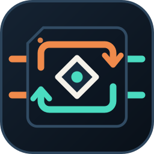
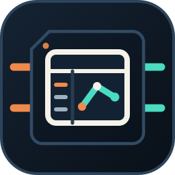

# Signal Forge v2 visual identity

Every RustEDA repository — the suite, five core engine/foundation modules, and RustEDA Studio — shares one precision IC die architecture, palette, typography, and animation contract.

## Mark geometry

Each `256 × 256` emblem places a distinct hardware glyph inside a chamfered Pin-1 silicon package with copper input leads on the left and mint output leads on the right:

| Product | Mark | Hardware symbol | Category tag |
| --- | --- | --- | --- |
| **RustEDA** | { width="40" } | Closed-loop silicon forge core | `RTL → GDS` |
| **RustSys** | { width="40" } | Logic gate with formal proof check | `SYNTHESIS` |
| **RustSTA** | { width="40" } | Clock launch edge, slew ramp & capture deadline | `TIMING` |
| **RustROAD** | { width="40" } | Orthogonal multi-layer metal tracks & vias | `PHYSICAL` |
| **RustSpice** | { width="40" } | Step excitation, transient wave & adjoint tangent | `SPICE + AD` |
| **RustEDA Common** | { width="40" } | Isometric arena, mmap & compute planes | `FOUNDATION` |
| **RustEDA Studio** | { width="40" } | Split die viewport & cross-probed path | `WORKBENCH` |

## Color tokens

| Token | Hex | Role |
| --- | --- | --- |
| Ink | `#0B121B` | Primary canvas & die substrate |
| Panel | `#121D2A` | Elevated stage cards |
| Border | `#273C4F` | Hairline bezels & inactive traces |
| Paper | `#F5F2EA` | Primary text & die symbols |
| Copper | `#F08A4B` | Inputs, actions & `Rust` prefix |
| Mint | `#4ADBC0` | Verified outputs, active paths & feedback |
| Slate | `#9EB1C0` | Secondary metadata |

## Wordmarks and animated banners

- **Wordmarks** use a `760 × 176` dark-bezel card with `width="360"` (no HTML `height` attribute) so GitHub renders them crisply across light and dark themes.
- **Banners** use a `1200 × 400` (3:1) Signal Forge v2 canvas with an 8.4-second loop (`84` frames × `100 ms`, `< 750 KB` GIF) showing stage-by-stage illumination, a runnable CLI command, and a matching `1200 × 400` SVG static poster paired via `<picture>` with `prefers-reduced-motion: reduce`.
- **Illustrative only**: animations depict data flow and architecture; quantitative benchmark claims belong strictly in receipt-backed tables with explicit scope.

Regenerate all seven asset sets offline via [`scripts/generate_brand.py`](../scripts/generate_brand.py):

```sh
python3 scripts/generate_brand.py
```

All marks, wordmarks, and banners are original vector artwork licensed under Apache-2.0. Product names and marks do not imply affiliation with any external tool, foundry, or benchmark design.
