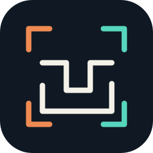

# RustEDA visual identity

All six modules share the same chip frame, copper/mint palette and three-second feedback animation. Only the central symbol and product title change.

[Canonical brand guide](https://lab-emi.github.io/RustEDA/brand/) · [Artwork generator](https://github.com/lab-emi/RustEDA/blob/main/scripts/generate_brand.py)

Use the SVG fallback for reduced motion, provide alternative text, and keep benchmark claims in their evidence tables. The artwork is original and licensed under Apache-2.0.
