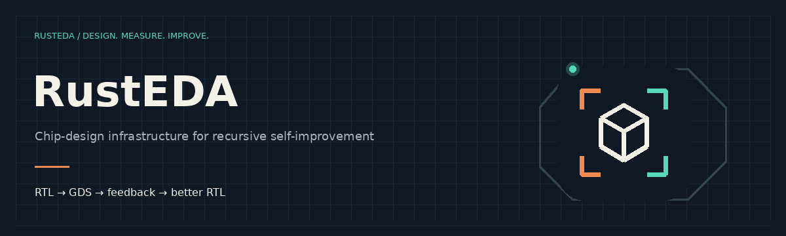

---
hide:
  - toc
  - navigation
---

DESIGN. MEASURE. IMPROVE.

# Infrastructure for chip-design self-improvement

Shorten the work between inference steps.

RustEDA connects native synthesis, timing and physical design with a revisioned
workspace. An agent proposes RTL. Tools implement and verify it. Measured feedback
guides the next iteration.

[Start building](development.md){ .md-button .md-button--primary }
[Explore the modules](modules.md){ .md-button }

<picture>
  <source media="(prefers-reduced-motion: reduce)" srcset="assets/rusteda-banner.svg">
  
</picture>

## RustEDA vs LibreLane at a glance

Ibex RTL-to-GDS on IHP SG13G2 with EZ130 cells and two SRAM macros, 2026-11-05: RustEDA and LibreLane 3.0.17 (OpenROAD, Yosys, KLayout, Magic, Netgen) ran one after the other on the same 4-vCPU host from the same prepared inputs, and the same signoff scripts checked both layouts.

**4.2× faster end to end** (974 s against 4,105 s with both flows' foundry
checks on the same schedule; 3.4× with every check run one after another), with a
**5.2 % smaller, 7.4 % shorter-wired layout, 3.0 % fewer vias and zero timing
violations** where LibreLane's layout has 112.

| Stage | RustEDA | LibreLane | RustEDA |
| --- | ---: | ---: | ---: |
| Synthesis | 3.48 s | 132.63 s | **38.1× faster** |
| Placement and clock tree | 28.00 s | 47.05 s | **1.7× faster** |
| Repair before detailed routing | 26.04 s | 52.36 s | **2.0× faster** |
| Routing, global and detailed | 302.24 s | 2,570.19 s | **8.5× faster** |
| Static timing in the flow | 35.42 s | 183.31 s | **5.2× faster** |
| Parasitic extraction | 13.08 s | 47.73 s | **3.6× faster** |
| GDS / DEF / netlist export | 2.09 s | 351.18 s | **168× faster** |
| Foundry DRC / antenna / LVS on each layout¹ | 403 / 198 / 147 s | 534 / 254 / 207 s | **1.3× / 1.3× / 1.4× faster** |
| Whole flow² | 888.90 s | 3,409.11 s | **3.8× faster** |
| **End to end** (flow + every signoff check) | **974.19 s** | **4,104.97 s** | **4.2× faster** |

| Quality of results | RustEDA | LibreLane | RustEDA |
| --- | ---: | ---: | ---: |
| Standard-cell area | 187,585.2 µm² | 197,913.7 µm² | **5.2 % smaller** |
| Routed signal wirelength | 897,357.3 µm | 969,571.6 µm | **7.4 % shorter** |
| Vias | 118,525 | 122,194 | **3.0 % fewer** |
| Capacitance / fanout violations, TT + SS | 0 | 112 | **timing-clean** |
| Setup worst slack, TT / SS | 49.64 / 49.44 ns | 48.60 / 47.84 ns | **+1.03 / +1.60 ns** |
| Synthesis and final equivalence | proven | unverified | **proven** |

| Module against its open-source counterpart | Speed | Peak memory | Quality |
| --- | --- | --- | --- |
| RustSys vs Yosys + ABC (LibreLane script) | **35.4× faster** (44.4× in direct mode) | **6.6× less** | 1.8 % less area, logic depth 36 vs 40, equivalence proven |
| RustSTA vs OpenSTA | **1.6× faster** at 2 threads, **2.0×** at 4 | 17.8 % / 6.3 % less | worst slacks within 0.164 ps |
| RustROAD routing vs OpenROAD (in the flow) | **8.5× faster** | — | 7.4 % less wire, 3.0 % fewer vias |
| RustROAD GDS export vs KLayout | **2.3× faster** | **2.0× less** | — |
| RustSpice vs ngspice-45 (extracted RC nets) | **4.3–6.0× faster** | **1.4–2.0× less** | closer to the reference in all 10 cases |

¹ Same scripts and decks on both layouts, interleaved runs at the same load (medians).
² RustEDA's flow time includes its own foundry DRC, antenna and LVS; LibreLane's does not.

LibreLane's layout fails the shared timing gate (112 maximum-capacitance and fanout violations at TT and SS) and its equivalence check does not complete, so the receipt keeps its own ratio fields null under its publication rule; the multiples here divide the recorded times. Stages are paired by phase, not as identical tasks. RustEDA is not faster everywhere: its repair before global routing takes 1.18× LibreLane's two pre-route resizer steps alone, OpenRCX runs 1.36× longer on RustEDA's DEF, and the latch-up check 1.11× longer on its layout. [All stages, gates and losses](benchmarks.md)

## Ibex SG13G2 / EZ130

The 2026-11-05 host campaign built Ibex with EZ130 cells and **two real IHP
SRAM macros** on a 4-vCPU cloud host, one timed sample per flow: the current
native recipe and LibreLane 3.0.17 read the same prepared inputs, and the same
nine independent gate scripts checked both layouts. **RustEDA's producer
completed every step, including the 1 ps RustSTA/OpenSTA parity gate, and its
layout passes every shared gate that gives a pass/fail verdict** (OpenRCX
extraction reports `extracted_not_qualified` on both layouts), with 187,585.2 µm² standard-cell area, 897,357.3 µm
of routed wire and 118,525 vias against LibreLane's 197,913.7 µm², 969,571.6 µm
and 122,194. LibreLane's layout fails the timing gate on max-capacitance and
fanout checks and its equivalence is `unverified`, so the receipt publishes no
cross-tool ratio; the end-to-end times were 974.19 s and 4,616.30 s. The native
run is `unqualified` (no published component-qualification evidence). RustEDA
leads every paired stage except two: the repair before global routing, where
LibreLane's two pre-route resizer steps are faster, and the flows' own OpenRCX
step (6.79 s against 5.557 s). Two shared gates, OpenRCX extraction and latch-up
tap coverage, run slower on its layout (the timing gate is level); module head-to-heads cover RustSys, RustSTA, RustROAD and RustSpice
(on extracted RC nets, not transistor level). The 2026-11-02 campaign, on
another host, stays on the benchmark page.

The retained R20/R21 native runs complete **129/129 steps and all 16 gates**, in
472.2 s and 472.6 s on 16 logical CPUs of an i9-13900HX; times from different
hosts are not comparable.

[Latest Ibex campaign →](benchmarks.md) · [Engine capabilities →](engine-status.md)

## Build the feedback loop

- { width="48" } **Synthesize**

    RTL, mapped cells and equivalence checks.

    [RustSys →](modules/rustsys/index.md)

- { width="48" } **Analyze timing**

    Constraints, parasitics and critical paths.

    [RustSTA →](modules/ruststa/index.md)

- { width="48" } **Implement**

    Placement, routing, extraction and GDS.

    [RustROAD →](modules/rustroad/index.md)

- { width="48" } **Simulate circuits**

    Differentiable SPICE waveforms and adjoint gradients.

    [RustSpice →](modules/rustspice/index.md)

- { width="48" } **Run and recover**

    Bounded execution and verified checkpoints.

    [Run a flow →](flows.md)

- { width="48" } **Inspect and act**

    Shared views, paths and revision-bound selections.

    [Open the workbench →](workbench/index.md)

- { width="48" } **Share a foundation**

    Models, formats, disk workspaces and compute.

    [RustEDA Common →](modules/rusteda-common/index.md)

## Faster tools. Faster iterations.

Chip-design RSI means iterating on a design using verified feedback. Accelerating
the work outside model inference improves the whole iteration only in proportion
to the time that work consumes. Amdahl's law makes that limit explicit.

  <label for="tool-fraction">Time spent in tools <output id="fraction-value">80%</output></label>
  <input id="tool-fraction" type="range" min="0" max="99" step="1" value="80">
  <label for="tool-speedup">Aggregate tool speedup <output id="tool-value">10×</output></label>
  <input id="tool-speedup" type="range" min="1" max="50" step="1" value="10">
  
<output id="iteration-speedup" aria-live="polite">3.57×</output> illustrative iteration speedup

  <small>1 / ((1 − f) + f / s). This is a model, not a measured RustEDA result.</small>

[Read the measurement scope](benchmarks.md#measurement-scope) ·
[Check current qualification](verification.md)

