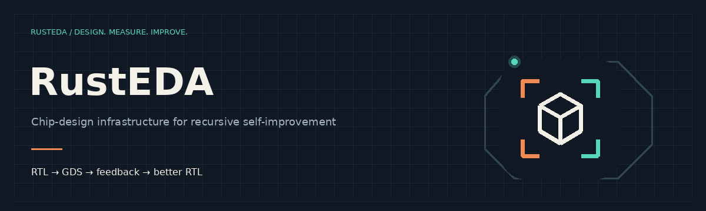

---
hide:
  - toc
  - navigation
---

DESIGN. MEASURE. IMPROVE.

# Infrastructure for chip-design self-improvement

Shorten the work between inference steps.

RustEDA connects native synthesis, timing and physical design with a revisioned
workspace. An agent proposes RTL. Tools implement and verify it. Measured feedback
guides the next iteration.

[Start building](development.md){ .md-button .md-button--primary }
[Explore the modules](modules.md){ .md-button }

<picture>
  <source media="(prefers-reduced-motion: reduce)" srcset="assets/rusteda-banner.svg">
  
</picture>

<strong>20.55×</strong>OpenC910 synthesis speedup

<strong>10.90%</strong>Less mapped cell area

<strong>Unverified</strong>OpenC910 RTL-to-GDS speedup

RustSys vs Yosys + ABC on SKY130 HD, 16 host cores. Synthesis and export only;
the measured boundary excludes proof and timing. [Results and limits](benchmarks.md).

## Build the feedback loop

- { width="48" } **Synthesize**

    RTL, mapped cells and equivalence checks.

    [RustSys →](modules/rustsys/index.md)

- { width="48" } **Analyze timing**

    Constraints, parasitics and critical paths.

    [RustSTA →](modules/ruststa/index.md)

- { width="48" } **Implement**

    Placement, routing, extraction and GDS.

    [RustROAD →](modules/rustroad/index.md)

- { width="48" } **Run and recover**

    Bounded execution and verified checkpoints.

    [Run a flow →](flows.md)

- { width="48" } **Inspect and act**

    Shared views, paths and revision-bound selections.

    [Open the workbench →](workbench/index.md)

- { width="48" } **Share a foundation**

    Models, formats, disk workspaces and compute.

    [RustEDA Common →](modules/rusteda-common/index.md)

## Faster tools. Faster iterations.

Chip-design RSI means iterating on a design using verified feedback. Accelerating
the work outside model inference improves the whole iteration only in proportion
to the time that work consumes. Amdahl's law makes that limit explicit.

  <label for="tool-fraction">Time spent in tools <output id="fraction-value">80%</output></label>
  <input id="tool-fraction" type="range" min="0" max="99" step="1" value="80">
  <label for="tool-speedup">Aggregate tool speedup <output id="tool-value">10×</output></label>
  <input id="tool-speedup" type="range" min="1" max="50" step="1" value="10">
  
<output id="iteration-speedup" aria-live="polite">3.57×</output> illustrative iteration speedup

  <small>1 / ((1 − f) + f / s). This is a model, not a measured RustEDA result.</small>

[Read the measurement contract](benchmarks.md#a-matched-rtl-to-gds-comparison) ·
[Check current qualification](verification.md)

