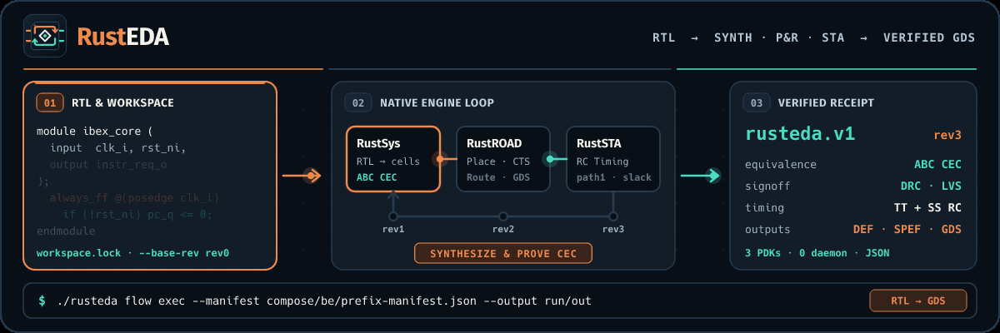

---
hide:
  - toc
  - navigation
---

CLEAN-ROOM · AI-AGENT-NATIVE · RUST

# From RTL to verified silicon, at native speed.

Daemonless revisioned workspaces, deterministic single-binary flows, formal equivalence, and verified speedups across three open PDKs and four open-source designs.

[Start building](development.md){ .md-button .md-button--primary }
[Three-PDK benchmarks](benchmarks/ibex-three-pdk.md){ .md-button }
[Explore modules](modules.md){ .md-button }

  

    <strong>7.95×</strong>
    IHP SG13G2 Ibex + 2 SRAMs to GDS (219.6 vs 1,745.5 s · 9/9 signoff PASS)
  

  

    <strong>3.55×</strong>
    Clean single-binary SKY130A Ibex (499.6 vs 1,771.8 s · 631 MiB RSS · 0/0 DRC · 0 DRV)
  

  

    <strong>5.4–8.4×</strong>
    Non-Ibex cores (PicoRV32, AES, SHA-256) on IHP SG13G2 · all 8/8 signoff PASS
  

  

    <strong>≤ 0.27 ps</strong>
    RustSTA vs OpenSTA parity at 2× speed &amp; 12.6–29.5% less RAM
  

<picture>
  <source media="(prefers-reduced-motion: reduce)" srcset="assets/rusteda-banner.svg">
  
</picture>

## Verified across three open PDKs and four designs

All comparisons run identical RTL, constraints, die areas, and independent signoff scripts against LibreLane 3.0.17 on quiet hardware with SHA-256-bound receipts.

| Benchmark (RustEDA / LibreLane) | RTL to GDS (s) | Speedup | Area & Power | SS Fmax (MHz) | Signoff Outcome |
| --- | ---: | ---: | --- | ---: | --- |
| **Ibex + 2 SRAMs** (IHP SG13G2, 3-block) | **219.6** / 1,745.5 | **7.95×** (`3.27×` signoff) | −9.1% area · −20.0% VCD | **43.42** / 24.86 | **9/9 PASS** (LL fails timing) |
| **Ibex + 2 OpenRAMs** (SKY130A, single binary, 3-block) | **499.6** / 1,771.8 | **3.55×** (`631 MiB` RSS) | −1.4% area · −35.3% vec. | **23.82** / 17.21 | **0/0 DRC · 0/0/0 DRV** (vs 3,035/381/64) · 14/13 ant. |
| **Ibex + 1 SRAM + fill** (GF180MCU D, 3-block) | **591.3** / 885.6 | **1.50×** (`1.53×` pub.) | −3.0% area · −3.3% VCD | **10.91** / 10.75 | **0/0 ant.** · LVS/Sim/ABC PASS · 1 vs 3 density |
| **`picorv32_top`** (IHP SG13G2, 50 ns) | **172.6** / 1,447.5 | **8.39×** (`4.1×` less RAM) | −21.8% power | **46.03** / 38.77 | **8/8 PASS** |
| **`aes_core`** (IHP SG13G2, 50 ns) | **291.6** / 1,931.3 | **6.62×** (`3.6×` less RAM) | −3.0% area · −11.8% WL | **64.12** / 37.63 | **8/8 PASS** |
| **`sha256_core`** (IHP SG13G2 / SKY130A) | **114.0** / 615.7 **249.5** / 397.0 | **5.40×** **1.59×** | `4.8×` less RAM (IHP) −16.9% power (SKY130) | **65.07** / 46.79 **37.03** / 33.01 | **8/8 PASS** (IHP) **0/0 DRC**, LVS/ABC PASS (SKY130) |

Under genuine tight-clock stress (`DELAY 4` in LibreLane), RustEDA leads IHP 25 ns (`45.0–49.5 vs 41.3 MHz`, `9.5×` faster, `9/9 PASS`) and SKY130A 40 ns (`31.93 vs 26.06 MHz`, `4.15×` faster, `0 vs 2` hold), while LibreLane stretches higher at ultra-tight IHP 20 ns (`50.5 vs 49.0 MHz`, `13.5×` slower, `107` SS DRVs) and GF180 65 ns (`16.58 vs 14.86 MHz`, failing SS hold `−0.228 ns` and zero-delay sim).

[Three-PDK Ibex Receipts →](benchmarks/ibex-three-pdk.md) ·
[Multi-Design Generalization →](benchmarks/multi-design.md) ·
[Tight-Clock Fmax →](benchmarks/tight-clock-fmax.md) ·
[Standalone Engine Benchmarks →](benchmarks.md)

## Modular Rust architecture

- { width="44" } **RustSys**

    33.8–47.4× faster RTL synthesis (`6.6×` less RAM), bounded AIG mapping, ABC CEC & reset-reachable FSM LEC.

    [Explore RustSys →](modules/rustsys/index.md)

- { width="44" } **RustSTA**

    2.0× faster multi-corner NLDM + SPEF RC timing (`≤ 0.270 ps` OpenSTA parity, 12.6–29.5% less RAM).

    [Explore RustSTA →](modules/ruststa/index.md)

- { width="44" } **RustROAD**

    Exact `i64` DBU placement, CTS, routing (`7.8×` faster), antenna repair, RC extraction & GDSII streamout (`2.8×`).

    [Explore RustROAD →](modules/rustroad/index.md)

- { width="44" } **RustSpice**

    4.1–7.0× faster RC simulation vs ngspice-45, SoA SIMD, Cranelift JIT sparse LU & `1× LᵀUᵀ` discrete adjoints.

    [Explore RustSpice →](modules/rustspice/index.md)

- { width="44" } **RustEDA Flow**

    Native step-graph executor (`rusteda flow exec`), `--base-rev` locking, JSONL event streaming & recovery.

    [Run a flow →](flows.md)

- { width="44" } **RustEDA Studio**

    Zero-daemon hierarchy, timing cone & RTL cross-probing synced live with CLI/agent selection handles.

    [Open Studio →](workbench/index.md)

- { width="44" } **RustEDA Common**

    Pinned five-crate foundation: generational arenas, strict format parsers, mmap workspaces & SoA compute.

    [Explore Foundation →](modules/rusteda-common/index.md)

## Faster tools, faster design loops

Accelerating synthesis, timing, and physical closure speeds up the whole human-or-agent iteration loop in proportion to tool time fraction (Amdahl's law):

  <label for="tool-fraction">Time spent in EDA tools <output id="fraction-value">80%</output></label>
  <input id="tool-fraction" type="range" min="0" max="99" step="1" value="80">
  <label for="tool-speedup">Aggregate tool speedup <output id="tool-value">10×</output></label>
  <input id="tool-speedup" type="range" min="1" max="50" step="1" value="10">
  
<output id="iteration-speedup" aria-live="polite">3.57×</output> illustrative iteration speedup

  <small>1 / ((1 − f) + f / s). Illustrative model, not a measured RustEDA result.</small>

[Measurement scope & historical campaigns](benchmarks.md#measurement-scope) ·
[Qualification & known limits](verification.md) ·
[Signal Forge v2 brand system](brand.md)

