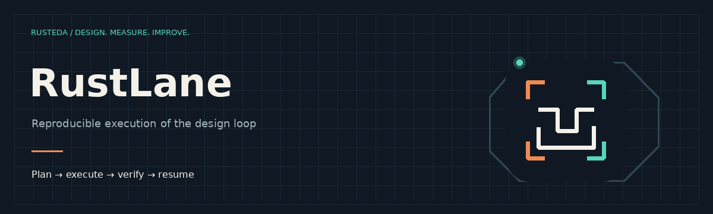

# RustLane

RustLane executes bounded tool processes and records revisioned checkpoints, input identities, outputs and recovery state. Its external-worker contract connects the RustEDA RTL-to-GDS flow.

[All RustEDA modules](https://lab-emi.github.io/RustEDA/)

<picture>
<source media="(prefers-reduced-motion: reduce)" srcset="assets/rustlane-banner.svg">

</picture>

- [Workspace architecture](architecture.md)
- [RustEDA worker](rusteda-worker.md)
- [Physical recipes](physical-recipes.md)
- [Engine contracts](verification/engine-contracts.md)
- [Process containment](verification/process-supervisor.md)
